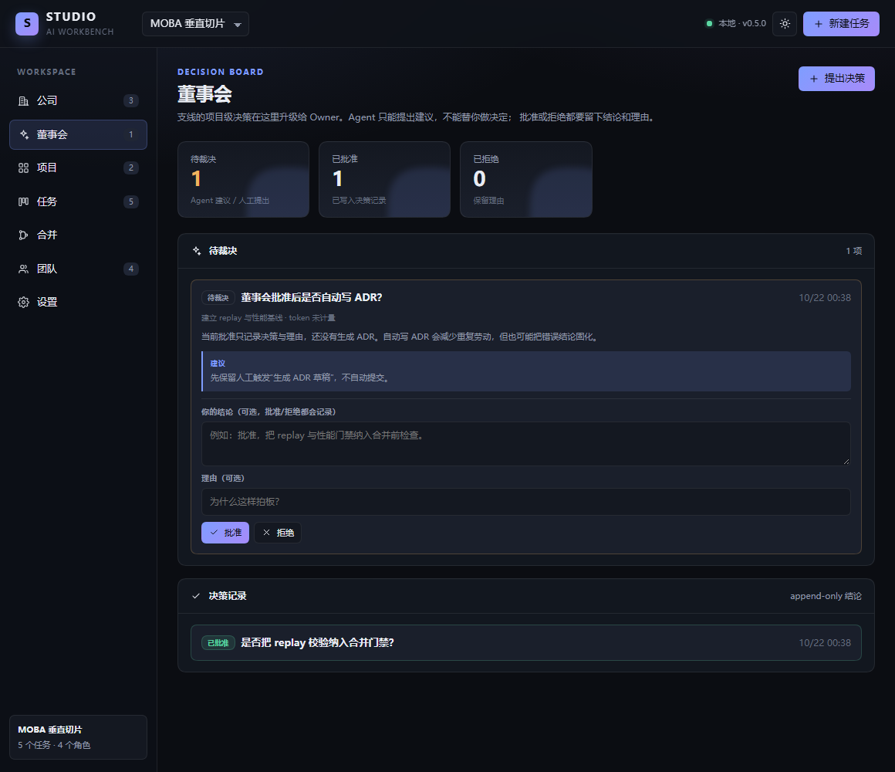

# AI 工作台（Studio）

一套构建在 **DeepSeek Harness（DSH）** 之上的多角色 AI 工作台：把「一个聊天窗口」变成一间**有公司仪表盘、Agent 派单、token 预算、决策董事会、支线/契约冲突、worktree 代码执行、项目、角色、任务、验收、合并治理**的工作室。

> 当前状态：**v1.9.0 可运行**。已完成公司级 Owner Dashboard、Agent 派单与结构化回执、角色模型/token 预算、DSH token 计量、决策董事会、支线/契约冲突自动升级、git worktree 代码执行、Host 独立验证、独立 AI 评审、自动集成分期、文档同步与不可逆决策门禁、ADR 草稿与落盘、人工触发 Git merge 与合并后回归、合并失败升级与回滚、改修票诊断/计划门禁、失败 2 次自动升级与重拆、合并前验证门禁、项目知识/模块契约、契约越界护栏、集成/playtest ticket、项目/角色/任务/验收/证据持久化、合并治理，并在 DSH `0.2.1-rc.2` 上完成 Web/桌面验证。



## 现在能做什么

- **公司仪表盘**：跨项目组合、老板收件箱、角色负载、风险雷达、交付流和 token 消耗；金额成本等报价接入后再显示。
- **决策董事会**：Agent 的项目级决策自动进入待裁决；Owner 批准/拒绝并记录结论与理由，Agent 不能替 Owner 拍板。
- **支线/契约冲突**：派单自动登记支线；两条支线改同一契约且内容不同时，自动升级为待裁决决策。
- **worktree 代码执行**：项目绑定 git 仓库后，每个任务自动创建独立 worktree 和分支；Agent 在里面改代码，Run 记录 diff，主工作区不被直接修改。
- **Host 独立验证**：Task Room 的验证命令由 Host 在 worktree 内执行，记录退出码/输出并写 evidence；不依赖 Agent 会话，也不会自动通过验收。
- **工作流护栏**：Task 记录模块/契约/票类型；连续失败 2 次自动 blocked 并升级决策；代码项目没有通过的验证不能提交合并提案。
- **知识层**：PRD/INVARIANTS/MODULES 只读查看；Module 契约卡记录职责、接口摘要、允许/禁止路径和依赖，派单时进入 Agent 上下文。
- **契约护栏**：代码 Run 改动契约文件、禁止路径或越出允许的 `src/`/`test/` 路径时，任务自动 blocked 并生成决策。
- **闭环 ticket**：集成/playtest ticket 标记；连续失败 2 次自动生成 Architect 重拆 ticket（backlog），不只是留一个决策。
- **独立 AI 评审**：验收人角色另开 Agent 会话，只读 diff/Host 验证输出，给出 pass/fail 与 findings；代码任务没有通过评审不能 done。
- **自动集成分期**：每完成 3 个任务自动生成一张 backlog 集成/playtest ticket，不自动派单。
- **文档同步门禁**：项目绑定 PRD/INVARIANTS/MODULES 时，任务 done 前必须勾选“文档已同步”。
- **不可逆决策**：Decision 可标记不可逆；批准时必须写结论和理由。
- **ADR 草稿**：不可逆决策批准后自动生成 Markdown ADR 草稿，保存在决策记录，不自动写文件。
- **评审同族提示**：评审模型与实现模型相同时，Task Room 警告共享盲点。
- **人工触发 Git merge**：已批准提案可在 Task Room 执行真实 `git merge --no-ff`；要求当前在 base、工作区干净、分支存在；冲突自动 abort，不自动 push。
- **合并后回归**：merge 成功后自动在 repo 执行任务验证命令，记录 pass/fail 和输出；失败不会自动回滚。
- **合并失败升级**：回归失败自动生成董事会决策，附 merge commit、回滚命令和修复选项。
- **ADR 落盘**：人工确认后写入 `docs/adr/`，自动编号，幂等。
- **合并回滚**：回归失败的 merge 可人工触发 `git revert`，记录 rollback commit；不 reset/push。
- **改修票工序**：`kind=fix` 必须有诊断和修改计划才能派单；UI 有字段和校验。
- **Agent 分析派单**：Task Room 把任务派给负责人角色，Agent 返回结构化回执；回执缺 `summary`/`evidence` 时任务退回可开始，不能进入验收。
- **薪资与预算**：角色配置模型、单任务/每日 token 预算；项目配置总 token 预算。
- **独立工作台页面**：DSH 侧栏点击「工作台」，进入公司仪表盘，不占用聊天会话。
- **项目**：创建/切换项目，任务和角色归属项目。
- **角色**：使命、职位、职责、决策权、模型与预算。
- **任务**：目标、负责人、验收人、优先级、分支、验收标准、证据。
- **验收门禁**：任务完成前必须勾完所有验收项，并至少记录一条证据；完成后锁定。
- **合并治理**：验收通过后可提交合并提案，记录摘要、风险、回滚、评审备注和合并提交；批准、打回、合并都有审计事件。
- **本地持久化**：`$DSH_HOME/studio/studio.json`，重启不丢；首次运行自动生成演示项目。
- **版本适配**：`engines.dsh >= 0.2.1-rc.2`；只依赖 Web Server 路由、client slots 和 React，不依赖私有 Remote 生成器。

## 合并治理


分支不会自己汇入主干。合并提案必须带摘要、风险、回滚和评审记录；批准后由人或 Integrator 执行 Git，Studio 记录状态与审计事件。

## 快速开始

插件在 [`packages/dsh-studio`](packages/dsh-studio/README.md)。

**桌面端**：Plugins → Add plugin → 本地目录填 `D:\AI工作台\packages\dsh-studio` → Enable now → 刷新页面。

**Web profile**：

```powershell
dsh plugin --profile web add "D:\AI工作台\packages\dsh-studio"
dsh --profile web
```

详细安装、打包分发、安全说明见 [插件 README](packages/dsh-studio/README.md)。

## 为什么不是「酒馆套壳」

酒馆的成熟之处是**内容与运行时分离**：世界书、角色卡、预设、正则、群聊。Studio 借这套经验，但把映射拆开：

- 世界书 → Project Book（检索层），不是项目本身；Canon 留在仓库里。
- 角色卡 → 角色契约的一部分；员工还需要职责、权限、交付和预算。
- 预设 → 运行时配置；权限/验收/合并门禁属于 Policy。
- 正则 → 确定性 Hook；控制面是状态机 + 验收 + 合并队列。
- 群聊 → 多独立会话 + 结构化消息 + 共享产物，不是同一个上下文里的轮转。

完整论证见 [设计蓝图](docs/00-设计蓝图.md)。

## 架构

```text
DSH Web/Desktop
  ├─ 独立页面（client plugin）
  │    Owner Dashboard / Decision Boardroom / Mission Control / Task Room / Merge Queue / Team / Settings
  └─ Host plugin
       ├─ /studio-api（同源、Bearer token、JSON）
       ├─ 文件存储（$DSH_HOME/studio/studio.json）
       ├─ 版本适配（app-boot → 安装包清单 → env）
       ├─ DSH Agent 派单（agents.create + agentPresets.mount + tokenMeter）
       └─ 状态机 / 验收门禁 / 合并治理 / 公司聚合
```

- Host 半是普通 Cordis 插件，依赖 `ctx.webServer` 与 `ctx.connection.admit()` 的认证边界。
- Client 半注册一个 `main` 面板和一个 `sidebar.panellist` 入口。
- 不依赖 DSH 私有 Remote 代码生成；API 是一层很薄的同源 HTTP JSON。
- 领域逻辑在 `src/shared` 和 `src/host/store.ts`，未来替换传输层不影响数据模型。

## 项目结构

```text
packages/dsh-studio/     # 可安装的 DSH 插件
  src/host/              # Cordis 插件、HTTP API、存储、兼容层
  src/client/            # React 页面
  src/shared/            # 跨端类型与状态机
  tests/                 # 存储层单测
docs/
  00-设计蓝图.md          # 产品/工作流/领域模型/路线
  01-对话补充与产品方向.md # 对象模型、决策升级、竞品参照、Owner Dashboard
  02-后续迭代.md          # v0.4-v1.0 的执行面、Scope、Git 与狗粮计划
  03-工作流评审与补充.md  # DSH/Kimi 对话对比与工作流缺口
  adr/                   # 架构决策
CONTEXT.md               # 术语表
tools/                   # CDP 端到端验证脚本
```

## 决策记录

- [ADR-0001：自建编排层](docs/adr/0001-studio-owns-orchestration.md)
- [ADR-0002：同源 HTTP + token](docs/adr/0002-same-origin-http-and-token.md)
- [ADR-0003：合并治理只记录状态](docs/adr/0003-record-only-merge-governance.md)
- [ADR-0004：公司仪表盘是派生投影](docs/adr/0004-company-is-a-derived-projection.md)
- [ADR-0005：Agent 派单先做只读分析](docs/adr/0005-agent-dispatch-is-advisory.md)
- [ADR-0006：项目级决策进入董事会](docs/adr/0006-decision-boardroom.md)
- [ADR-0007：支线自动登记与契约冲突升级](docs/adr/0007-branch-contract-escalation.md)
- [ADR-0008：代码执行放在每 Task 的 worktree](docs/adr/0008-code-execution-in-worktrees.md)
- [ADR-0009：Host 独立验证](docs/adr/0009-host-verification.md)
- [ADR-0010：项目知识与模块契约](docs/adr/0010-project-knowledge-and-modules.md)
- [ADR-0011：契约越界护栏](docs/adr/0011-contract-scope-guard.md)
- [ADR-0012：重拆票与集成票](docs/adr/0012-resplit-and-integration-tickets.md)
- [ADR-0013：独立 AI 评审](docs/adr/0013-independent-ai-review.md)
- [ADR-0014：自动集成分期](docs/adr/0014-automatic-integration-gate.md)
- [ADR-0015：文档同步与不可逆决策](docs/adr/0015-docs-sync-and-irreversible-decisions.md)
- [ADR-0016：人工触发 Git merge](docs/adr/0016-human-triggered-git-merge.md)
- [ADR-0017：ADR 草稿保存于决策记录](docs/adr/0017-adr-draft-in-decision.md)
- [ADR-0018：合并后回归](docs/adr/0018-post-merge-regression.md)
- [ADR-0019：合并失败升级](docs/adr/0019-post-merge-failure-decision.md)
- [ADR-0020：ADR 落盘与合并回滚](docs/adr/0020-adr-writeback-and-merge-rollback.md)
- [ADR-0021：改修票诊断/计划门禁](docs/adr/0021-fix-ticket-diagnosis-plan.md)

## 开发

```powershell
pnpm install
pnpm typecheck
pnpm build
pnpm test
```

端到端验证使用本机 DSH Web profile + Chrome CDP：

```powershell
# 1. 启动测试 profile（不要占用当前 GUI）
dsh --profile web --no-open --port 0
# 2. 用 tools/cdp-check.mjs 打开打印出的 URL
```

（`tools/` 是开发验证脚本，不随插件发布。）

## 路线

- **v0.1**：项目/角色/任务/验收/证据；独立页面；本地持久化；版本适配。
- **v0.2**：合并提案、批准、打回、合并记录；schema v1→v2 迁移。
- **v0.3**：Owner Dashboard；公司级项目组合、老板收件箱、角色负载、风险雷达、交付流。
- **v0.4**：Agent 分析派单与结构化回执；角色模型/token 预算；项目预算；DSH token 计量。
- **v0.5**：决策董事会；Agent 项目级决策进入待裁决；Owner 批准/拒绝与结论记录。
- **v0.5.1**：支线持久化、契约变更记录、跨支线同契约冲突自动升级。
- **v0.6**：项目绑定 git 仓库、每 Task worktree/branch、Agent 代码编辑与 diff 记录。
- **v0.6.1**：Host 独立验证、验证 evidence、Merge Proposal 的 diff/变更文件/验证结果。
- **v0.7**：Task 模块/契约/票类型、失败 2 次自动升级、代码项目合并前验证门禁。
- **v0.8**：PRD/INVARIANTS/MODULES 知识层、Module 契约卡、派单加载模块契约。
- **v0.9**：契约越界护栏、契约/禁止路径改动自动 blocked + 决策。
- **v1.0**：集成/playtest ticket、连续失败自动生成 Architect 重拆 ticket。
- **v1.1**：独立 AI 评审、代码任务 done 前评审门禁。
- **v1.2**：每 3 个完成任务自动生成 backlog 集成/playtest ticket。
- **v1.3**：文档同步门禁、不可逆决策批准必须写理由。
- **v1.4**：人工触发真实 Git merge，冲突自动 abort。
- **v1.5**：不可逆决策生成 ADR 草稿、评审同族风险提示。
- **v1.6**：merge 后自动回归并记录结果。
- **v1.7**：合并后回归失败自动生成董事会决策，附回滚建议。
- **v1.8**：ADR 落盘 + 人工触发合并回滚。
- **v1.9（当前）**：改修票诊断/计划门禁。
- **v2.0**：真实项目 dogfood、项目级阈值/回滚策略、发布候选。
- **v1.0**：用工作台完成一个 2.5D MOBA 垂直切片，再抽象为可复用插件。

详细迭代计划见 [后续迭代](docs/02-后续迭代.md)。

## 核心原则

1. **LLM 提议，系统裁决**：Agent 不能自己把任务标记为完成。
2. **产物优先，会话可弃**：状态和知识落在文件里。
3. **一个产物一个写入者**：跨角色只发请求，不直接改对方记忆。
4. **短分支，频繁合并**：分支是隔离手段，不是长期分叉。
5. **人类持有最终决策权**：方向、预算、不可逆选择、安全与权限。
6. **先狗粮，后抽象**：每个功能都要被真实任务使用过。

## 许可

MIT
