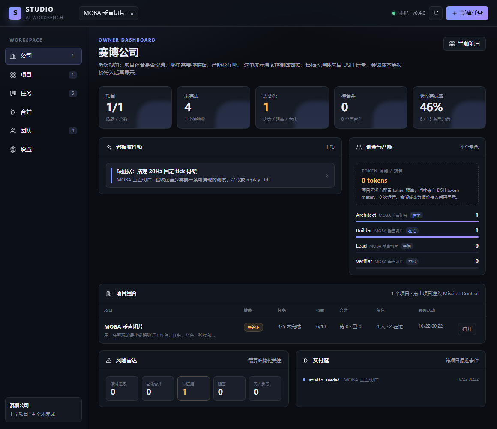

# AI 工作台（Studio）

一套构建在 **DeepSeek Harness（DSH）** 之上的多角色 AI 工作台：把「一个聊天窗口」变成一间**有公司仪表盘、Agent 派单、token 预算、项目、角色、任务、验收、合并治理**的工作室。

> 当前状态：**v0.4.0 可运行**。已完成公司级 Owner Dashboard、Agent 分析派单与结构化回执、角色模型/token 预算、项目预算、DSH token 计量、项目/角色/任务/验收/证据持久化、合并治理，并在 DSH `0.2.1-rc.2` 上完成 Web 端到端验证。



## 现在能做什么

- **公司仪表盘**：跨项目组合、老板收件箱、角色负载、风险雷达、交付流和 token 消耗；金额成本等报价接入后再显示。
- **Agent 分析派单**：Task Room 把任务派给负责人角色，Agent 返回结构化回执；回执缺 `summary`/`evidence` 时任务退回可开始，不能进入验收。
- **薪资与预算**：角色配置模型、单任务/每日 token 预算；项目配置总 token 预算。
- **独立工作台页面**：DSH 侧栏点击「工作台」，进入公司仪表盘，不占用聊天会话。
- **项目**：创建/切换项目，任务和角色归属项目。
- **角色**：使命、职位、职责、决策权、模型与预算。
- **任务**：目标、负责人、验收人、优先级、分支、验收标准、证据。
- **验收门禁**：任务完成前必须勾完所有验收项，并至少记录一条证据；完成后锁定。
- **合并治理**：验收通过后可提交合并提案，记录摘要、风险、回滚、评审备注和合并提交；批准、打回、合并都有审计事件。
- **本地持久化**：`$DSH_HOME/studio/studio.json`，重启不丢；首次运行自动生成演示项目。
- **版本适配**：`engines.dsh >= 0.2.1-rc.2`；只依赖 Web Server 路由、client slots 和 React，不依赖私有 Remote 生成器。

## 合并治理


分支不会自己汇入主干。合并提案必须带摘要、风险、回滚和评审记录；批准后由人或 Integrator 执行 Git，Studio 记录状态与审计事件。

## 快速开始

插件在 [`packages/dsh-studio`](packages/dsh-studio/README.md)。

**桌面端**：Plugins → Add plugin → 本地目录填 `D:\AI工作台\packages\dsh-studio` → Enable now → 刷新页面。

**Web profile**：

```powershell
dsh plugin --profile web add "D:\AI工作台\packages\dsh-studio"
dsh --profile web
```

详细安装、打包分发、安全说明见 [插件 README](packages/dsh-studio/README.md)。

## 为什么不是「酒馆套壳」

酒馆的成熟之处是**内容与运行时分离**：世界书、角色卡、预设、正则、群聊。Studio 借这套经验，但把映射拆开：

- 世界书 → Project Book（检索层），不是项目本身；Canon 留在仓库里。
- 角色卡 → 角色契约的一部分；员工还需要职责、权限、交付和预算。
- 预设 → 运行时配置；权限/验收/合并门禁属于 Policy。
- 正则 → 确定性 Hook；控制面是状态机 + 验收 + 合并队列。
- 群聊 → 多独立会话 + 结构化消息 + 共享产物，不是同一个上下文里的轮转。

完整论证见 [设计蓝图](docs/00-设计蓝图.md)。

## 架构

```text
DSH Web/Desktop
  ├─ 独立页面（client plugin）
  │    Owner Dashboard / Mission Control / Task Room / Merge Queue / Team / Settings
  └─ Host plugin
       ├─ /studio-api（同源、Bearer token、JSON）
       ├─ 文件存储（$DSH_HOME/studio/studio.json）
       ├─ 版本适配（app-boot → 安装包清单 → env）
       ├─ DSH Agent 派单（agents.create + agentPresets.mount + tokenMeter）
       └─ 状态机 / 验收门禁 / 合并治理 / 公司聚合
```

- Host 半是普通 Cordis 插件，依赖 `ctx.webServer` 与 `ctx.connection.admit()` 的认证边界。
- Client 半注册一个 `main` 面板和一个 `sidebar.panellist` 入口。
- 不依赖 DSH 私有 Remote 代码生成；API 是一层很薄的同源 HTTP JSON。
- 领域逻辑在 `src/shared` 和 `src/host/store.ts`，未来替换传输层不影响数据模型。

## 项目结构

```text
packages/dsh-studio/     # 可安装的 DSH 插件
  src/host/              # Cordis 插件、HTTP API、存储、兼容层
  src/client/            # React 页面
  src/shared/            # 跨端类型与状态机
  tests/                 # 存储层单测
docs/
  00-设计蓝图.md          # 产品/工作流/领域模型/路线
  01-对话补充与产品方向.md # 对象模型、决策升级、竞品参照、Owner Dashboard
  02-后续迭代.md          # v0.4-v1.0 的执行面、Scope、Git 与狗粮计划
  adr/                   # 架构决策
CONTEXT.md               # 术语表
tools/                   # CDP 端到端验证脚本
```

## 决策记录

- [ADR-0001：自建编排层](docs/adr/0001-studio-owns-orchestration.md)
- [ADR-0002：同源 HTTP + token](docs/adr/0002-same-origin-http-and-token.md)
- [ADR-0003：合并治理只记录状态](docs/adr/0003-record-only-merge-governance.md)
- [ADR-0004：公司仪表盘是派生投影](docs/adr/0004-company-is-a-derived-projection.md)
- [ADR-0005：Agent 派单先做只读分析](docs/adr/0005-agent-dispatch-is-advisory.md)

## 开发

```powershell
pnpm install
pnpm typecheck
pnpm build
pnpm test
```

端到端验证使用本机 DSH Web profile + Chrome CDP：

```powershell
# 1. 启动测试 profile（不要占用当前 GUI）
dsh --profile web --no-open --port 0
# 2. 用 tools/cdp-check.mjs 打开打印出的 URL
```

（`tools/` 是开发验证脚本，不随插件发布。）

## 路线

- **v0.1**：项目/角色/任务/验收/证据；独立页面；本地持久化；版本适配。
- **v0.2**：合并提案、批准、打回、合并记录；schema v1→v2 迁移。
- **v0.3**：Owner Dashboard；公司级项目组合、老板收件箱、角色负载、风险雷达、交付流。
- **v0.4（当前）**：Agent 分析派单与结构化回执；角色模型/token 预算；项目预算；DSH token 计量。
- **v0.5**：Branch/Decision/Scope 隔离、决策升级门禁、Project Book、汇入冲突“董事会”视图。
- **v0.6**：Git worktree、自动合并/合并队列执行、独立评审。
- **v1.0**：用工作台完成一个 2.5D MOBA 垂直切片，再抽象为可复用插件。

详细迭代计划见 [后续迭代](docs/02-后续迭代.md)。

## 核心原则

1. **LLM 提议，系统裁决**：Agent 不能自己把任务标记为完成。
2. **产物优先，会话可弃**：状态和知识落在文件里。
3. **一个产物一个写入者**：跨角色只发请求，不直接改对方记忆。
4. **短分支，频繁合并**：分支是隔离手段，不是长期分叉。
5. **人类持有最终决策权**：方向、预算、不可逆选择、安全与权限。
6. **先狗粮，后抽象**：每个功能都要被真实任务使用过。

## 许可

MIT
