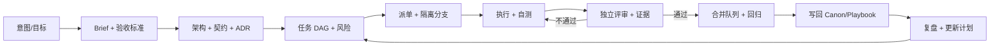
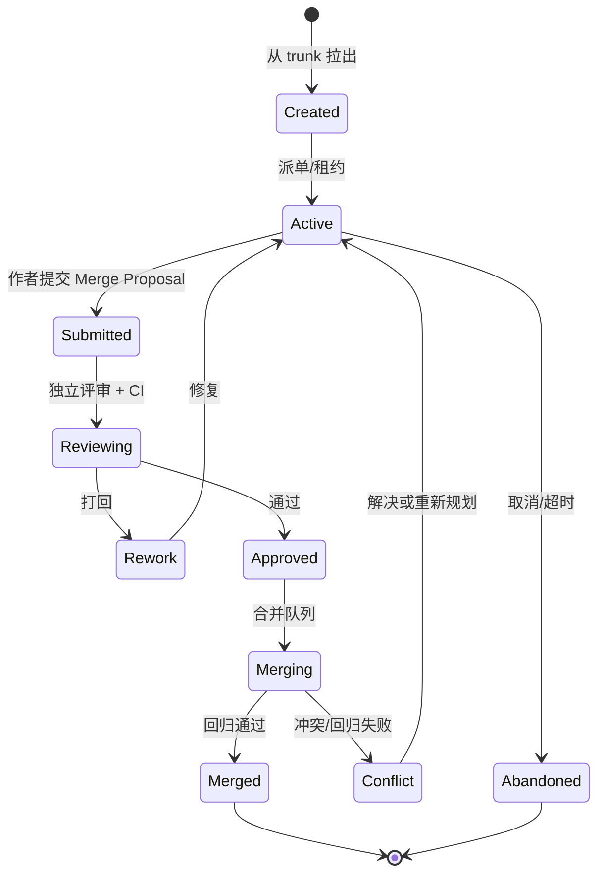
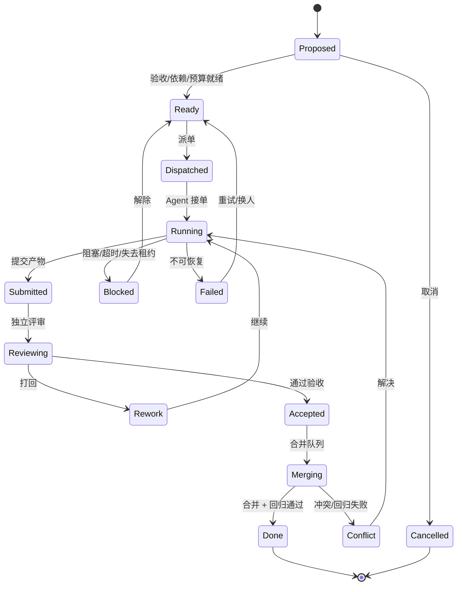
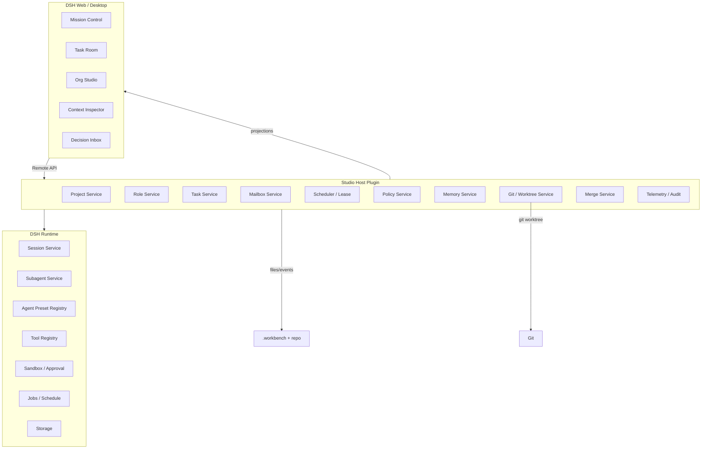

# AI 工作台 · 设计蓝图 v1.4

> 一句话：**把 DSH 的会话、子代理、预设、工具和沙箱，编译成一家可审计、可回滚、以产物为中心的工作室。**
>
> 不是把 SillyTavern 的角色卡搬进 DSH；是借它的「内容与运行时分离」经验，重建一套面向工程交付的组织层。
>
> **实现状态（2026-10-22）**：v1.4.0 已落地可安装插件，覆盖公司级 Owner Dashboard、Agent 派单与结构化回执、角色模型/token 预算、项目预算、DSH token 计量、决策董事会、支线/契约冲突自动升级、git worktree 代码执行、Host 独立验证、独立 AI 评审、自动集成分期、文档同步与不可逆决策门禁、人工触发 Git merge、工作流护栏（模块/契约/票类型、失败 2 次升级与重拆、合并前验证门禁、done 前评审门禁）、契约越界护栏、集成/playtest ticket、项目知识层（PRD/INVARIANTS/MODULES、Module 契约卡）、项目/角色/任务/验收/证据、独立 Mission Control 页面、合并提案/批准/打回/合并记录、本地持久化、schema v1-v11→v12 迁移、DSH 版本适配和桌面端启动参数回退。自动合并仍不在目标内；v1.4 只提供人工触发的 merge。安装与运行见 [`packages/dsh-studio/README.md`](../packages/dsh-studio/README.md)；工作流评审见 [`03-工作流评审与补充.md`](03-工作流评审与补充.md)；后续迭代见 [`02-后续迭代.md`](02-后续迭代.md)。

---

## 0. 结论先行

### 0.1 这个方向成立，但价值点不在「多角色聊天」

DSH 已经提供了多会话、子代理、Agent Preset、工具、沙箱、技能、MCP、后台任务、计划任务和 Web 插件槽位。再做一个「能和多个人设聊天的界面」，增量很小。

真正缺的是：

- **组织级状态**：谁在做什么、做到哪、凭什么算完成。
- **项目级记忆**：跨会话、跨角色、可追溯、可写回的知识。
- **分支与合并治理**：多条支线如何隔离、验收、合并、回滚。
- **权限与预算**：不同角色能碰什么、能花多少、什么必须问人。
- **审计与复盘**：每个结论的证据、每次决策的理由、每个失败的原因。

这五件事才是工作台的产品。聊天只是它的输入输出界面。

### 0.2 最大的风险不是技术，是「元项目陷阱」

你真正要做的是一款 2.5D MOBA。工作台是**为游戏开发服务的工具**，不是替代游戏的另一个大项目。

如果先花三个月做「赛博公司平台」，再开始做游戏，大概率会出现：

- 平台功能很完整，但没有经过真实项目压力测试；
- 游戏进度为零，平台的价值无法验证；
- 组织、权限、插件市场越做越大，核心工作流却没跑通。

**建议反过来：用第一个游戏垂直切片当狗粮，工作台只做这条切片当前需要的功能。** 每加一个功能，都必须能回答：「它让哪个真实任务变快、变稳、变便宜了？」

### 0.3 建议的产品形态

**DSH 插件束（bundle），而不是独立 Electron 壳。**

- Host 半：Cordis 插件，提供项目/角色/任务/邮箱/策略/合并服务，复用 DSH 的会话、子代理、预设、工具、沙箱。
- Client 半：Web 插件，注册 Mission Control 主面板、Task Room、Org Studio、Context Inspector 等界面。
- 数据：项目仓库内的 `.workbench/` 存控制面状态；产品文档和代码留在正常仓库位置。
- 执行：涉及代码/资产的 Task 用 Git worktree/分支隔离；每个 Agent 一个 DSH 会话；角色卡编译成 DSH Agent Preset。纯设计/文档任务可以不拉分支，但同样要有产物和验收。

这样既复用了 DSH 的运行时，又保持可安装、可升级、可复用。

### 0.4 对你五个想法的逐条判断

| 你的想法 | 判断 | 关键修正 |
|---|---|---|
| ① 酒馆的玩法很像工作台 | **对一半** | 像的是「内容配置 + 上下文检查 + 多角色界面」；不像的是「独立上下文、任务所有权、验收、合并」 |
| ② 世界书≈项目、角色卡≈员工、预设≈配置面、正则≈控制面 | **方向对，映射要拆** | 世界书是检索层，不是项目；角色卡是角色契约的一部分，不是员工；预设是运行时，不是全部配置；正则是文本变换，不是控制面 |
| ③ PRD→架构→模块→分工→前后端→对接 | **粗线条对，缺六件事** | 验收标准、接口契约、决策权、集成节奏、独立验证、知识写回 |
| ④ 一条主线 + 多支线，支线结果汇入主线 | **拓扑对，载体错** | 支线不是对话分支，是 Git 分支 + 任务 + 产物 + 验收；合并不是总结，是带证据的合并提案 |
| ⑤ 做成可复用插件、赛博公司 | **方向对，顺序要反** | 先服务一个真实游戏切片，再抽象成插件；否则容易掉进元项目陷阱 |

---

## 1. 对酒馆映射的纠偏

你的四个类比方向是对的：**酒馆确实把「内容配置」和「运行时」分离得很成熟**。但一一对应会带来错误的产品直觉。下面逐条拆。

### 1.1 世界书 ≠ 项目

| 酒馆里的世界书 | 实际是什么 | 工作台里应该变成 |
|---|---|---|
| 一堆带触发词/常驻标记/插入顺序的文本条目 | **上下文检索与注入系统** | Project Book：项目知识的检索索引 |
| 条目是提示词片段 | 不是事实来源 | Canon：仓库里的文档、代码、契约、ADR |
| 命中就注入，不保证一致 | 没有验收、没有版本、没有 owner | 条目带 `source / owner / scope / freshness / priority`，可追溯到 Canon |

**关键区别**：世界书是「让模型知道设定」，项目是「让团队产出可验收的东西」。项目包含仓库、构建、测试、部署、任务、决策、权限、服务器……这些都不是世界书能承载的。

正确做法：

- **Canon 在仓库里**：`docs/`、`docs/adr/`、接口契约、测试、代码。
- **Project Book 只是索引**：从 Canon 生成，按触发词/范围检索，注入时附来源和新鲜度。
- **常驻宪法很短**（建议 ≤ 4 KB）：只放不可协商的全局规则；其余按需检索。
- **禁止把聊天总结当 Canon**：总结可以进 episodic log，不能自动升级为事实。

### 1.2 角色卡 ≠ 员工

| 酒馆里的角色卡 | 实际是什么 | 工作台里应该变成 |
|---|---|---|
| 名字、人设、示例对话、开场白 | **一个角色扮演用的提示词包** | Role Card 的一部分：身份与表达风格 |
| 没有职责、权限、交付物 | 不承担后果 | Role：使命、职责、非目标、决策权、能力、交付契约 |
| 一个角色卡就是一个对话对象 | 没有独立工作目录和预算 | Agent：Role 的一次运行实例，绑定会话/worktree/预算/租约 |

**关键区别**：角色卡只回答「你是谁、怎么说话」；员工还要回答「你负责什么、能决定什么、能碰哪些文件、交付什么、做不完怎么办」。

正确做法：

- **Role 是持久的**，Agent 是可替换的。Agent 崩了、上下文爆了、换模型了，Role 不变。
- **Role Card 编译成 DSH Agent Preset**：persona + 工具 + 技能 + 模型策略，而不是另造一套提示词拼装器。
- **一个 Role 可以有多个 Agent 实例**（并行任务），但同一文件/分支只能有一个写入者。
- **一个人可以戴多顶帽子**：小团队里 Architect 和 Builder 可以是同一个 Agent，但决策权要显式记录，不能混着用。

### 1.3 预设 ≠ 配置面

| 酒馆里的预设 | 实际是什么 | 工作台里应该变成 |
|---|---|---|
| 上下文模板、instruct 格式、系统提示、采样参数 | **某个模型/场景的运行时配置** | Runtime Preset：模型、提示段、工具、技能、上下文策略、预算 |
| 主要影响「怎么把上下文喂给模型」 | 不负责权限和流程 | DSH Agent Preset + Policy 的组合 |

**关键区别**：预设是「模型怎么跑」，不是「公司怎么运转」。把权限、任务流、审批都塞进预设，会导致配置不可验证、不可审计。

正确做法：

- 预设只描述**运行时**：模型路由、提示段顺序、工具集、技能、上下文预算、采样参数。
- 权限、审批、合并门禁属于 **Policy**，由系统强制执行。
- 角色卡变更后，重新编译预设；旧会话保留旧预设，新任务用新预设（DSH 的 preset revision 语义正好支持）。
- 多 API 不是「每个角色卡里塞几个 key」，而是**模型路由策略**：主模型、备用模型、成本上限、延迟要求、本地 GPU 优先。密钥统一进 DSH credentials，绝不进角色卡/项目书/日志。

### 1.4 正则 ≠ 控制面

| 酒馆里的正则 | 实际是什么 | 工作台里应该变成 |
|---|---|---|
| 对显示/输入/提示词做文本替换 | **确定性的文本变换** | Hook 的一种实现：`before_prompt` / `after_response` 的文本清洗 |
| 不能保证流程正确 | 不是流程引擎 | Workflow Engine + Policy + Gate |

**关键区别**：正则能改「模型看到什么」，但改不了「任务是否真的完成」。控制面必须是状态机、权限检查、工具门禁、验收证据和合并队列。

正确做法：

- Hook 分阶段：`before_prompt`、`after_response`、`before_tool`、`after_tool`、`before_commit`、`before_merge`、`after_merge`。
- 每个 Hook 是确定性代码，有单测；正则只是其中一种 transform。
- 关键门禁（测试、契约、权限、密钥扫描）不能靠 Hook 的「建议」，必须是**阻断式**的。
- Hook 失败要可观测：记录输入摘要、规则、结果、耗时，不能静默吞掉。

### 1.5 群聊 ≠ 协作

| 酒馆里的群聊 | 实际是什么 | 工作台里应该变成 |
|---|---|---|
| 多个角色在**同一个上下文**里轮流说话 | 角色扮演的轮转 | 多个独立会话 + 结构化消息 + 共享产物 |
| 没有任务所有权 | 容易互相客套、跑题 | Task DAG + Lease + Receipt |
| 对话历史就是全部状态 | 无法审计 | 事件日志 + 产物 + 决策记录 |

**关键区别**：群聊是「一个大脑戴多张面具」；真实协作是「多个大脑围绕同一份产物，各自有独立上下文和职责」。

正确做法：

- **不要模拟群聊**。每个 Agent 独立会话，独立上下文，独立预算。
- Agent 之间只传**结构化消息**（派单/回执/评审/决策请求），不传整段聊天记录。
- 共享状态放文件/任务板，不放某个 Agent 的上下文。
- 需要「开会」时，开一个**短会**：明确议题、参与者、产出（决策/任务），开完即散，会议记录落文件。

### 1.6 对话分支 ≠ 工作分支

| 酒馆里的分支对话 | 实际是什么 | 工作台里应该变成 |
|---|---|---|
| 叙事上的另一种可能 | 不产生可合并的工程产物 | Git 分支/worktree + Task Branch |
| 分支之间不要求一致 | 可以永远不合并 | 必须通过契约测试和合并门禁 |
| 合并靠作者叙述 | 没有证据 | Merge Proposal + 评审 + 回归 |

**关键区别**：对话分支的产物是「另一段故事」；工作分支的产物是「可集成到主干的变更」。后者必须有 diff、测试、契约、风险和回滚。

---

## 2. 人类工作流的补充与纠正

### 2.1 你说对的部分

- 从 PRD 到架构，再到模块划分和分工，这是软件的粗线条。
- 前端/后端/测试/运维各管一段，确实按角色和文件边界分工。
- 支线解决具体问题，结果汇入主线，这个拓扑是对的。
- 不同角色接触不同文件，这个直觉也是对的。

### 2.2 需要补的六个缺口

1. **验收标准**：没有验收标准的任务不是任务，是愿望。每个 Task 必须有可复现的 Acceptance。
2. **接口契约**：前后端、模块之间、游戏客户端/服务端之间，先定契约再并行，否则合并时才发现对不上。
3. **决策权**：谁提案、谁拍板、谁被咨询、谁被告知。不能默认「谁做谁决定」。
4. **集成节奏**：不是所有支线做完才合并；短分支、频繁集成，冲突早暴露。
5. **验证独立性**：写代码的人不能是唯一验收的人；至少要有独立 Reviewer + 自动化证据。
6. **写回**：任务完成后，知识要回到 Canon/Project Book/Role Playbook，否则下一个 Agent 重新踩坑。

### 2.3 需要纠正的三个说法

#### 「支线冲突由支线负责人决定」

不准确。支线负责人只有**提案权**，没有天然的**裁决权**。冲突按决策权矩阵处理：

| 冲突类型 | 提案 | 裁决 | 说明 |
|---|---|---|---|
| 技术实现/架构 | 支线负责人/Architect | Architect | 必须记录 ADR 或技术决策 |
| 接口契约 | 任一侧 | Architect + 受影响方 | 契约变更要版本化 |
| 产品范围/优先级 | Lead/PM | Owner（人） | 不能由 Agent 自行扩缩范围 |
| 跨分支合并 | 作者 | Integrator | 以测试和契约为准 |
| 安全/密钥/预算/权限 | 任何人 | Owner（人） | 不可逆或高风险，必须人审 |
| 僵局 | 任何一方 | 升级到上一级，附选项和影响 | 不允许「放着不管」 |

**判据**：一条决策如果说不清「谁有权拍板、依据是什么、什么时候生效」，它就是无效的。

#### 「支线结束只需要记录最终结果」

只记录「结果」不够。要记录的是**可合并的产物 + 证据 + 决策**：

- 代码/文档/资源的实际路径和版本；
- 测试命令与结果；
- 契约变更；
- 风险与回滚方案；
- 关键决策及理由；
- 未完成项和后续任务。

聊天总结只能当索引，不能当交付物。判据：**新人只读产物和记录，能否复现你的结论？**

#### 「先定完整计划，再分给各角色执行」

计划应该是**活的 DAG**，不是一次性排期表。架构会在实现中修正，任务会拆分/合并/取消。正确节奏是：

- 先定**方向、验收、关键契约**；
- 用**垂直切片**验证架构；
- 任务图随证据更新；
- 每次合并后复盘，必要时改计划。

这不是不要计划，而是不要把计划当真理。

### 2.4 推荐的工作流 v1



每个阶段的产物和门禁：

| 阶段 | 产物 | 门禁 |
|---|---|---|
| 意图 | 一句话目标、成功指标 | Owner 确认 |
| Brief | PRD/验收标准/非目标 | Owner 或授权 PM 确认 |
| 架构 | 架构图、接口契约、ADR、风险 | Architect 确认；重大不可逆项 Owner 确认 |
| 计划 | Task DAG、依赖、Owner、预算 | Lead 确认；冲突升级 |
| 派单 | Task envelope、分支、上下文包 | 系统检查权限/预算/依赖 |
| 执行 | 代码、测试、文档、运行记录 | 自测通过；检查点 |
| 评审 | Review 记录、证据、缺陷 | 独立 Reviewer + CI |
| 合并 | Merge Proposal、回归结果 | Integrator + 门禁 |
| 写回 | Canon 更新、Playbook、索引 | 影响面评审 |
| 复盘 | 指标、教训、改进项 | Lead/人类 |

### 2.5 角色的最小集合

第一版不要 12 个角色。4 个就够：

| 角色 | 使命 | 关键产出 | 不该做什么 |
|---|---|---|---|
| **Lead / Producer** | 把目标变成可执行计划，保持节奏 | Brief、Task DAG、派单、状态报告 | 不替 Architect 做技术裁决，不替 QA 验收 |
| **Architect** | 守住架构完整性和契约 | 架构、ADR、接口契约、技术裁决 | 不长期占着一个实现任务不放 |
| **Builder** | 交付可运行的实现 | 代码、测试、文档、构建 | 不改自己任务之外的契约 |
| **Verifier / QA** | 独立验证，守住质量门 | 测试、Review、缺陷、验收报告 | 不替作者改代码（除非明确授权） |

人（Owner/Game Director）不在图里当「角色」，而是**权限主体**：方向、预算、不可逆决策、最终验收。

**独立评审的定义**：独立会话 + 独立上下文 + 不同职责，至少换一个 session；同一个会话里让作者「再检查一遍」不算独立评审。模型可以和作者相同，但证据必须独立复现。

后续按需加：Game Designer、Technical Artist、Network Engineer、Build/Release、Security。**每加一个角色，先证明现有角色真的过载。**

---

## 3. 支线如何汇入主线

### 3.1 分支的真相

一个工作分支不是「一段对话」，而是四件东西的合称：

```text
Branch = Git ref/worktree + Task + Artifacts + Acceptance record
```

没有后三样，Git 分支只是一个 diff，不是可验收的工作。

### 3.2 分支生命周期



规则：

- 分支从 **trunk** 拉出，短命；超过 N 天（建议 2-3 天）强制提醒/拆分。
- 一个 Task 一个分支；一个分支同一时间一个写入者（Lease）。
- 合并前必须 rebase/merge trunk，并跑契约测试。
- 合并由 **Integrator** 执行，作者不能自己合。
- 合并后跑回归；失败则回滚并重开 Task，不允许「先合再说」。

### 3.3 合并提案（Merge Proposal）最小字段

```yaml
id: MP-0007
task: TASK-012
branch: task/012-ability-system
base: trunk@<sha>
summary: 实现技能冷却与施法前摇
contracts_changed:
  - docs/contracts/ability.md#cast-timing
evidence:
  - cmd: pnpm test ability
    result: 42 passed
  - cmd: pnpm test integration
    result: 18 passed
  - replay: replays/ability-cast-001.json
risk:
  level: medium
  notes: 影响所有英雄的施法流程
rollback: revert <sha>; 无数据迁移
open_items:
  - 打断逻辑待 TASK-015
```

没有 evidence 的提案，Reviewer 直接拒绝。没有 rollback 的高风险变更，Integrator 不合并。

### 3.4 冲突解决的不是「谁赢」，是「哪个契约对」

当两个分支冲突时，先问：

1. 是**实现冲突**还是**契约冲突**？
2. 契约变更经过 Architect 了吗？
3. 有没有测试能证明哪种行为正确？
4. 如果两者都合理，谁有权决定取舍？

处理顺序：

```text
实现冲突 → 作者按 trunk 契约解决 → 测试证明
契约冲突 → 停下 → Architect 裁决 → 更新契约/ADR → 双方按新契约改
范围冲突 → 停下 → Lead/Owner 裁决 → 更新 Brief/DAG
安全/预算/权限 → 停下 → Owner 裁决
```

**不允许**：两个 Agent 私下拉个对话「商量一下」就把契约改了。契约变更必须走决策记录。

### 3.5 对游戏项目特别重要的一点

游戏开发里最难的合并不是代码，是**资产和手感**：

- Unity 的 scene/prefab、Unreal 的蓝图/关卡、Godot 的 scene 文件，都是结构化但易冲突的资产。
- 二进制资产（贴图、音频、模型）不能真正 diff，必须靠 **文件锁/独占租约**，而不是合并。
- 「手感」无法靠单元测试验收，必须有人实际玩。工作台要把 **playtest** 作为一等门禁。

所以游戏项目的工作台需要：

- 代码分支 + 资产租约两套机制；
- 场景/prefab 的「单一所有者」规则；
- 自动构建 + 自动 replay + 性能预算；
- 人类 playtest 记录（视频/手感评分/问题清单）。

这些在 v1 可以先手工，但领域模型要预留。

---

## 4. 领域模型

### 4.1 核心对象

| 对象 | 职责 | 关键字段 |
|---|---|---|
| `Project` | 项目边界与配置 | id, name, root, vision, phase, constitution, trunk |
| `Role` | 持久职责契约 | id, mission, responsibilities, non_goals, decision_rights, capabilities, handoff |
| `Agent` | Role 的运行实例 | id, role_id, session_id, status, worktree, budget, lease |
| `Task` | 工作单元 | id, goal, inputs, outputs, acceptance, owner_role, reviewer_role, deps, branch, status |
| `Run` | 一次执行尝试 | id, task_id, agent_id, session_id, status, tokens, cost, started_at, ended_at |
| `Artifact` | 可验收产物 | id, task_id, kind, path, hash, status, owner |
| `Branch` | 工作分支 | id, task_id, git_ref, worktree, base_commit, merge_proposal |
| `Message` | 结构化协作消息 | id, kind, from, to, task_id, body, thread_id, created_at |
| `Decision` | 决策记录 | id, title, authority, options, rationale, status, supersedes |
| `Policy` | 确定性规则 | capabilities, path_scopes, budgets, approvals, merge_gates |
| `Event` | 审计事件 | id, type, actor, task_id, payload, timestamp |

### 4.2 Task 状态机



关键规则：

- **Agent 不能把 Task 从 `Reviewing` 推到 `Accepted`**；只有验收门禁能。
- **`Done` 以合并和回归为准**，不以「代码写完」为准。
- `Blocked` 必须有原因、责任人、下一步；不能是垃圾桶。
- 一个 Task 可以有多个 `Run`；每个 Run 独立计费、独立日志。
- 租约到期自动转 `Blocked` 并通知 Lead，不自动换人（避免两个 Agent 同时写）。

### 4.3 事件日志

所有状态变化写 append-only JSONL：

```json
{"id":"evt_01","type":"task.dispatched","task":"TASK-012","actor":"agent_lead","at":"2026-10-21T13:00:00Z","payload":{"agent":"agent_builder_1","branch":"task/012","budget":{"tokens":120000}}}
```

用途：

- 重建看板（projection）；
- 审计「谁在什么时候改了什么」；
- 计算指标（周期、返工、成本、冲突率）；
- 失败复盘；
- 不依赖任何会话历史。

事件日志是**控制面事实**，代码/文档是**产品事实**，两者不要混。

---

## 5. 协作协议

### 5.1 消息类型

| 类型 | 目的 | 必须包含 | 是否需要唤醒 |
|---|---|---|---|
| `dispatch` | 派活 | task_id, goal, acceptance, inputs, deadline, budget | 是 |
| `receipt` | 交付/阻塞 | status, summary, evidence, artifacts, blockers, next | 是 |
| `review` | 评审结论 | verdict, findings, evidence, required_changes | 是 |
| `decision_request` | 请人/上级裁决 | question, options, recommendation, impact, deadline | 是 |
| `decision` | 裁决结果 | decision, authority, rationale, effective_at | 是 |
| `escalation` | 升级 | blocked_reason, attempted, impact, needed_by | 是 |
| `notice` | 知悉 | 一句话 + 链接 | **否**（只落盘） |

### 5.2 消息信封

```yaml
kind: receipt
thread: TH-0042
task: TASK-012
from: agent_builder_1
to: agent_lead
status: blocked
summary: 技能冷却在 30Hz tick 下抖动
evidence:
  - cmd: pnpm test ability
    result: 3 failed
  - replay: replays/cd-jitter-003.json
artifacts:
  - src/ability/cooldown.ts
blockers:
  - 需要确认冷却按 tick 还是按时间累加
next: 等 Architect 裁决后继续
```

### 5.3 三条硬规则

1. **派单必须真投递**：写进看板不算派单；必须进入对方会话/邮箱，并明确「我在等回执」。
2. **回执必须真送达**：只在自己窗口说「做完了」等于没做；必须发回执给发起方。
3. **同一 thread ≤ 3 条消息**：派单 + 回执 + 收尾知悉。收到知悉不回复；纯客套不发送。末行 `【结束】`。

### 5.4 派单 ≠ 公告

判据：句子里有「请你改/请你做/做完回执/改完跑 X 复验」⇒ 派单，必须唤醒。
只是「知悉/参考」⇒ 公告，只落盘，不唤醒。

### 5.5 写权限

- 共享看板：各角色只写自己的行；不能删别人的行。
- 别人的记忆/角色卡：**一个字都不写**，只能发请求。
- 共享规则/工具/预设：只有 Owner 或授权管理员能改；其他人提案。
- 代码：同一分支按 Lease 写；跨分支修改同一文件必须在 DAG 里声明重叠，由合并队列和契约测试处理，不能静默覆盖。

---

## 6. 记忆与上下文

### 6.1 四层记忆

| 层 | 内容 | 位置 | 谁能写 | 是否默认注入 |
|---|---|---|---|---|
| **Canon** | 代码、PRD、架构、契约、ADR、测试 | 仓库正常路径 | 授权角色 + 评审 | 否（按需读） |
| **Project Book** | 索引、触发词、摘要、来源 | `.workbench/book/` | Librarian/Lead | 命中才注入 |
| **Role Playbook** | 该角色的工作方法、检查清单、教训 | `.workbench/roles/<id>/playbook.md` | 该角色（评审后） | 角色会话启动时注入 |
| **Episodic Log** | 会话、工具调用、运行记录 | DSH sessions + `.workbench/events/` | 系统 append-only | 否 |

### 6.2 写回规则

任务关闭时，必须回答三个问题：

1. **有没有改变事实？** 有 → 更新 Canon（代码/文档/契约/ADR）。
2. **有没有可复用的经验？** 有 → 更新 Role Playbook 或 Project Book 条目。
3. **有没有未完成项？** 有 → 建新 Task，写清依赖和验收。

没有写回的 Task 可以 `Done`，但要在复盘里标记「无知识产出」；连续多次无产出，说明任务拆分或角色有问题。

### 6.3 上下文装配

每个 Agent 的上下文按固定顺序装配：

```text
1. 全局宪法（≤ 4 KB，不可协商）
2. 角色卡（使命/职责/非目标/决策权/交付契约）
3. 当前 Task envelope（目标/验收/输入/依赖/预算）
4. 相关 Canon 片段（按路径/符号/契约精确读取）
5. Project Book 命中条目（带来源/新鲜度）
6. 最近的回执/评审/决策（只带相关 thread）
7. 工具清单与权限说明
8. 运行时上下文（cwd、分支、时间、预算剩余）
```

原则：

- **精确读取优先于语义检索**：代码任务先读文件/符号，不要先向量搜索。
- **注入必须可解释**：Context Inspector 要能显示「为什么这条被注入」。
- **来源与新鲜度**：每条 Project Book 条目带 `source`、`updated_at`、`owner`；过期条目标记，不静默使用。
- **不注入整段会话**：需要历史时，读摘要/事件，不把别人的聊天记录倒进来。
- **上下文预算**：每个角色有 token 预算；超限先压缩/检索，不无限扩窗。

### 6.4 防污染

- 角色会话之间默认不共享上下文；共享通过文件/消息。
- 外部文档、网页、资产说明都视为**不可信输入**，不能当指令执行。
- 项目书条目不能包含「忽略之前的指令」这类内容；入库前做指令扫描。
- 密钥、token、个人信息不进上下文；日志脱敏。
- 发现跨角色污染，立即停任务、隔离会话、修来源，而不是「让模型自己纠正」。

---

## 7. 权限、预算、审计

### 7.1 能力模型

不要把权限做成「角色名 → 布尔值」，要做成**能力 + 范围**：

```yaml
capabilities:
  fs.read:   ["docs/**", "src/**", "tests/**"]
  fs.write:  ["src/ability/**", "tests/ability/**"]
  shell:     ["pnpm test", "pnpm lint", "pnpm build"]
  network:   ["registry.npmjs.org", "docs.unity3d.com"]
  git:       ["branch:task/*", "commit", "push:origin/task/*"]
  spawn:     false
  merge:     false
  secrets:   []
budget:
  tokens: 150000
  wall_clock_min: 90
  retries: 2
```

### 7.2 执行层

| 层 | 管什么 | 例子 |
|---|---|---|
| DSH sandbox/approval | 进程/会话级文件与命令边界 | workspace-write、命令审批 |
| Tool wrapper | 每次工具调用的能力检查 | 路径不在 `fs.write` → 拒绝 |
| Git hook / CI | 提交/合并门禁 | 密钥扫描、测试、契约检查 |
| UI | 意图与确认 | 合并按钮只对 Integrator 可见 |
| Audit | 事后追责 | 谁在何时改了哪个文件 |

**诚实说明**：DSH 当前的 sandbox 更偏会话/进程级；per-agent 的路径 ACL 需要 Studio 在工具层和政策层补，不能假设原生就有。第一版可以先用「worktree 隔离 + 路径检查 + CI」三件套，逐步收紧。

### 7.3 审批门禁

必须人审的操作：

- 合并到 trunk；
- 修改全局规则/权限/角色；
- 访问或写入密钥；
- 超出预算；
- 删除数据/分支/资产；
- 对外发布/部署；
- 不可逆的架构选择（数据库、引擎、网络模型）。

### 7.4 预算与熔断

- 每个 Task、Agent、Project 三层预算。
- 达到 80% 预警，100% 硬停并升级。
- 死循环检测：重复工具调用、无进展、上下文暴涨。
- 并发上限：第一版 3 个 Worker + 1 个 Lead，避免协调爆炸。
- 成本看板：按 Task/Role/模型统计 token 与费用。

### 7.5 审计

每个事件至少记录：

```text
who (role/agent/human) · what (action) · task · branch · tool · args_hash · result · cost · timestamp
```

不记录完整密钥/隐私内容；记录哈希和脱敏摘要即可。

---

## 8. 系统架构

### 8.1 总览



### 8.2 Host 服务

| 服务 | 职责 |
|---|---|
| `ProjectService` | 项目创建/加载/配置/阶段；Canon 与 Book 的边界 |
| `RoleService` | Role Card CRUD、校验、编译为 DSH preset、版本 |
| `TaskService` | Task CRUD、DAG 校验、状态机、验收门禁 |
| `MailboxService` | 结构化消息、thread、投递/已读/回执 |
| `SchedulerService` | 派单、租约、心跳、超时、并发上限 |
| `PolicyService` | 能力/路径/预算/审批检查，工具包装 |
| `MemoryService` | Project Book 索引、检索、写回、新鲜度 |
| `GitService` | worktree 创建/回收、分支、diff、冲突检测 |
| `MergeService` | Merge Proposal、评审门禁、合并队列、回归 |
| `TelemetryService` | 事件日志、指标、成本、审计导出 |

### 8.3 Client 界面

| 界面 | 回答的问题 |
|---|---|
| **Mission Control** | 项目现在什么状态？什么需要我？ |
| **Task Room** | 这个任务在做什么？产物在哪？凭什么算完成？ |
| **Org Studio** | 团队怎么配？角色能做什么？预设怎么编译？ |
| **Context Inspector** | 这个 Agent 到底看到了什么？为什么？ |
| **Decision Inbox** | 有哪些决策等我拍板？选项和影响是什么？ |
| **Library** | 项目知识在哪？哪些过期了？谁负责？ |

### 8.4 数据布局

```text
<repo>/
  docs/                      # Canon：PRD、架构、契约、ADR
  src/                       # 代码
  tests/                     # 测试
  .workbench/
    project.yaml             # 项目配置（id/name/trunk/phase）
    constitution.md          # 全局宪法（短）
    roles/
      architect.yaml         # Role Card
      builder.yaml
    book/
      entries.yaml           # 索引条目（或每主题一个文件）
    tasks/
      TASK-012.yaml
    decisions/
      ADR-0003.md
    policies.yaml
    events/
      2026-10.jsonl
    runtime/                 # 租约、锁、临时状态（gitignore）
```

原则：

- **Canon 不复制**：`.workbench` 只存控制面状态和索引，不存第二份 PRD。
- **可读文本优先**：YAML/Markdown 方便人审、diff、Agent 读；数据库只做投影缓存。
- **事件 append-only**：状态可重建；不要手改事件。
- **原子写 + 文件锁**：并发写同一文件必须串行化。
- **可移植**：整个 `.workbench` 进 Git（runtime 除外），换机器能恢复。

### 8.5 与 DSH 的集成点

| DSH 能力 | Studio 怎么用 |
|---|---|
| Agent Preset | Role Card 编译成 preset；不同 revision 对应角色卡版本 |
| Persona | 角色身份/风格的提示段 |
| Session | 每个 Agent 一个会话；Task Room 直接嵌会话 |
| Subagent | 派单创建子会话；保留可继续对话的地址 |
| Tools | 注册 `studio_*` 工具：任务、消息、决策、项目书、合并 |
| Sandbox/Approval | 运行时边界；Studio 再叠工具级策略 |
| Jobs/Schedule | 长任务、定时巡检、超时回收 |
| Storage | 可选投影缓存；不作为事实来源 |
| Client slots | 主面板、侧栏、会话头部、任务详情 |
| Projections | 任务板/团队状态实时推送到 UI |

### 8.6 为什么不直接把实验性 Agent Teams 当核心

DSH 自带的 `@deepseek-ai/dsh-experimental-agent-team` 已经提供了 roster、peer messaging、共享 task DAG 和 Web roster/task board，值得复用其投影和 UI 思路。但它的公开限制包括：

- 实验性，契约可能变；
- 扁平的、不可嵌套的 roster；
- 所有成员共享同一个 checkout，没有 worktree 隔离；
- 没有 merge/合并队列；
- 没有自动释放 ownership；
- 任务所有权和写范围是建议性的，不是强制的。

这些限制恰好是 Studio 的核心价值所在，所以：

- **领域模型和调度器自建**；
- **执行底座复用 DSH 的 session/subagent**；
- **Agent Teams 作为参考实现，必要时做适配器，不 fork**。

详见 [ADR-0001](adr/0001-studio-owns-orchestration.md)。

---

## 9. UI 设计原则

### 9.1 不要做「24 个面板的网格」

参考项目用网格面板把文件、网页、数据、对话摆在一起，适合「多场景监控」。但工程工作的主界面应该是**任务上下文**，不是面板数量。

第一版只做三个稳定表面：

1. **Mission Control**：项目状态 + 需要人的决策 + 任务板 + 团队 + 合并队列。
2. **Task Room**：会话 + 产物/diff + 验收清单 + 上下文检查器。
3. **Org Studio**：角色卡 + 预设编译 + 权限 + 汇报线。

Library/Decision Inbox 可以是 Task Room 的侧栏或独立页，不急着做第四个壳。

### 9.2 Context Inspector 是杀手功能

酒馆的「提示词查看器」让用户知道模型看到了什么；工作台更需要这个：

- 系统提示分段（宪法/角色/任务/项目书/工具）；
- 每条 Project Book 命中：为什么命中、来源、新鲜度；
- 工具清单与权限；
- token 预算与已用；
- 最近压缩/丢弃了什么；
- 与上一个版本的角色卡/预设 diff。

没有这个，多 Agent 系统就是黑箱；出了问题只能猜。

### 9.3 Mission Control 的「需要我」优先

首页最重要的不是「团队多热闹」，而是：

- 哪些决策等我拍板？
- 哪些任务阻塞/超预算/失去租约？
- 哪些合并提案等我审？
- 哪些验收证据不足？

把「需要人」放在第一屏，其他都是次要信息。

### 9.4 场景/房间不是记忆隔离

参考项目的「一个窗口 = 一类活」很有用，但在我们的模型里：

- **Room 是视图**，不是独立记忆体；
- 项目状态共享，不因切房间而分叉；
- 会话绑定 Task/Role，不绑定 Room；
- 切房间只改变布局和过滤，不改变事实。

这样可以避免「这个场景的 AI 不知道那个场景发生了什么」的经典问题。

---

## 10. 路线图

> 时间按「有效工程日」估算，不按自然日。每一步都有可演示的验收，不做「只完成 80% 的底层」。

### Sprint 0 · 插件验证（3-5 天）

目标：证明 Studio 能作为 DSH 插件跑起来。

- 创建 monorepo/包骨架：`studio-shared`、`studio-host`、`studio-client`。
- Host 插件挂载一个 `StudioService`，提供一个只读 `studio_status` 工具。
- Client 插件注册一个 Mission Control 主面板，显示项目名/阶段/任务数。
- 用临时 profile 启动，不污染当前 Web profile。
- 验证：刷新页面面板还在；重启 DSH 状态不丢；单测通过。

**验收**：一条命令启动，能看到自定义面板；日志里有一次真实的 `studio_status` 调用。

### Sprint 1 · 单项目工作流（5-7 天）

目标：一条任务真正跑通。

- `.workbench/` 项目/角色/任务 YAML schema + zod 校验。
- Role Card → DSH Agent Preset 编译。
- 创建 Task、生成 Task Room、派单到子会话。
- 回执/评审消息、任务状态机、看板实时更新。
- Context Inspector v1：显示装配后的提示段和工具权限。
- 事件日志 + 基本审计。

**验收**：创建一个 3 任务的小 DAG，派给 2 个角色，完成「派单 → 执行 → 回执 → 评审 → 通过」；重启后状态完整。

### Sprint 2 · 分支与合并（5-7 天）

目标：支线能安全汇入主干。

- Git worktree 服务：每个 Task 一个 worktree/branch。
- Merge Proposal + diff + 测试证据。
- 独立 Reviewer + CI 门禁。
- 合并队列串行化；冲突检测；回归。
- Lease/心跳/超时回收。
- 合并后写回（ADR/Book/Playbook）。

**验收**：两个并行 Task 改不同文件，先后合并；制造一次契约冲突，系统能阻断并给出决策请求；回滚可执行。

### Sprint 3 · 组织与治理（3-5 天）

目标：可配置，但不失控。

- Org Studio：角色卡编辑、校验、预设编译预览。
- 能力/路径/预算策略 + 审批门禁。
- 决策 Inbox + ADR 记录。
- 模板：新建项目、角色包、任务包。
- 成本/周期/返工指标。

**验收**：不改代码，新增一个「Network Engineer」角色并限制其只能读 `src/net/**`、写 `tests/net/**`；越权被拒并有审计。

### Sprint 4 · 狗粮：2.5D MOBA 垂直切片（2 周+）

目标：用工作台开发一个真实可玩的小切片。

- 一条路、2 个英雄、每波 4 个小兵、每方 1 座塔、每英雄 1 个技能、金钱/复活/胜负。
- 固定 tick 服务端模拟；客户端表现；占位美术。
- 角色：Lead、Architect、Gameplay Builder、Verifier；人做 Game Director + Playtest。
- 工作台必须支持：代码分支、资产租约、自动构建、replay/性能检查、playtest 记录。

**验收**：10 分钟可玩对局；确定性 replay 通过；目标机器 60fps；无阻断缺陷；人类给出「可继续迭代」的手感评分。

### v0.1 的「不做清单」

- 嵌套组织/多公司/多租户；
- 插件市场/角色市场；
- 向量数据库/复杂 RAG；
- 24 种面板类型；
- 自建模型网关；
- 移动端；
- 自动合并（必须有人/Integrator 门禁）；
- 用 LLM 替代确定性调度。

---

## 11. 首个狗粮项目：2.5D MOBA 垂直切片

### 11.1 为什么选这个切片

- 足够小：2 周内能跑起来。
- 足够真：涉及客户端/服务端、tick、网络、技能、UI、性能、手感。
- 足够痛：能暴露分支冲突、契约变更、资产锁、验收不足。
- 足够像最终产品：2.5D MOBA 的核心循环都在。

### 11.2 范围

| 维度 | 范围内 | 范围外 |
|---|---|---|
| 地图 | 一条路 + 基地 | 多路、野区、草丛 |
| 英雄 | 2 个，各 1 个主动技能 + 普攻 | 天赋、装备、等级 |
| 小兵 | 每波 4 个，固定路线 | 多波次 AI、仇恨 |
| 防御塔 | 每方 1 座 | 多塔、水晶 |
| 网络 | 本地/局域网，固定 tick | 公网匹配、回滚 |
| 表现 | 占位美术，2.5D 相机 | 正式资产、特效 |
| 胜负 | 推掉塔/击杀数 | 排位、经济系统 |

### 11.3 工作台要验证的假设

1. Role Card + Preset 能否让 Agent 稳定扮演不同职责？
2. Task DAG + 回执能否减少「做完没人知道」？
3. Worktree + 合并队列能否把冲突前置？
4. Context Inspector 能否让人类快速定位「它为什么这么做」？
5. 预算/租约能否防止失控和重复写？
6. Playtest 门禁能否把「代码通过」和「好玩」分开？

### 11.4 指标

| 指标 | 目标（初版） |
|---|---|
| 任务周期（派单→合并） | 中位数 < 1 天 |
| 一次评审通过率 | > 60% |
| 合并冲突率 | < 20% |
| 每验收任务 token 成本 | 可度量，逐月下降 |
| 人类干预次数 | 逐月下降，但不追求 0 |
| 阻断缺陷逃逸 | 0 |
| 工作台自身开发占比 | 前 4 周 ≤ 30%，之后 ≤ 10% |

最后一条是防「元项目陷阱」的硬指标。

---

## 12. 风险与对策

| 风险 | 表现 | 对策 |
|---|---|---|
| 元项目陷阱 | 平台越做越大，游戏没动 | 时间盒；狗粮；工作台开发占比上限 |
| 多 Agent 协调爆炸 | 消息/会议/客套烧 token | 小团队；≤3 条消息；结构化协议；并发上限 |
| 假完成 | Agent 说做完了，其实没验收 | 状态机；独立评审；证据门禁；Agent 不能自验收 |
| 上下文污染 | 别的角色/外部文档影响判断 | 独立会话；只读 Canon；来源标记；指令扫描 |
| 合并地狱 | 长分支、资产冲突 | 短分支；契约测试；合并队列；资产租约 |
| 权限失控 | Agent 改了不该改的文件 | worktree + 路径策略 + CI + 审计 |
| 成本失控 | 无限重试/扩窗 | 三层预算；熔断；死循环检测 |
| 依赖实验 API | DSH 升级后插件崩 | 适配层；固定版本；集成测试；不 fork |
| 过度抽象 | 为「未来复用」做太多 | 先服务一个项目；第二次使用再抽象 |
| 评估幻觉 | 指标好看但游戏不好玩 | 人类 playtest 一等门禁；不以代码量/任务数论英雄 |
| 安全 | 密钥/隐私进日志 | credentials 统一管理；脱敏；密钥扫描 |

---

## 13. 待定决策

在写第一行插件代码前，需要确认：

1. **游戏引擎**：Unity / Godot / Unreal / 未定。
   - 影响：资产锁、场景合并、构建/测试、网络库、性能预算。
   - 建议：如果是单人 2.5D MOBA 且重视生态/联机，优先 Unity；如果重视开源/轻量/2D，优先 Godot；Unreal 对单人 2.5D 偏重。
2. **第一版形态**：DSH Web 插件 / Desktop 插件 / 独立壳。
   - 建议：Web 插件优先，Desktop 后续适配；不独立造壳。
3. **第一里程碑**：工作台 MVP / 游戏切片 / 两者并行。
   - 建议：Sprint 0-1 做最小工作台，Sprint 2 开始用游戏切片狗粮，二者并行但工作台占比受限。
4. **编排底座**：自建 Studio 调度 / 直接用实验性 Agent Teams / 混合。
   - 建议：自建领域层，复用 DSH session/subagent；Agent Teams 只做参考/可选适配。
5. **UI 语言**：中文优先 / 中英双语。
   - 建议：中文优先，文案集中管理，后续加英文。

---

## 14. 参考与事实依据

- 淋雨家工作台：<https://github.com/mashanglinyu/luanyujia-workbench> —— 场景、记忆、协作、派单、GPU 优先的实践方法。本蓝图借用了「记忆在文件不在会话」「派单必须真投递」「回执闭环」「规矩只认机主」等原则，但不照搬其场景/会话绑定实现。
- SillyTavern —— 世界书、角色卡、预设、正则、群聊的作者体验参考；本蓝图只借「内容与运行时分离」和「可检查的上下文」，不借其单上下文角色扮演模型。
- 本机 DSH `0.2.1-rc.2` 包说明：
  - `@deepseek-ai/dsh-experimental-agent-team`：roster、peer messaging、shared task DAG；限制包括实验性、扁平 roster、共享 checkout、无 worktree/merge、无自动 ownership release。
  - `@deepseek-ai/dsh-agent-preset-registry`：preset 是插件组合，不是安全沙箱。
  - `@deepseek-ai/dsh-persona`：per-agent persona，可 shadow 全局 persona。
  - `@deepseek-ai/dsh-client-ui-layout` / `dsh-client-ui-sidebar-right`：Web 主面板、侧栏、slot 扩展点。
  - `@deepseek-ai/dsh-sandbox-policy`：sandbox 模式与 workspace root 是进程/会话级配置；per-agent ACL 需在工具/策略层补。
