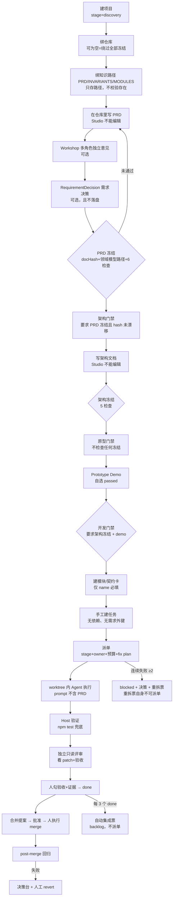

# dsh-ai-studio 工作流深度分析

> 基线：`dsh-ai-studio@3.12.0`，`schemaVersion 33`，49 个 tag，105 个 commit，2026-10-21 → 2026-11-05。
> 方法：**代码是事实来源，文档是宣称**。凡是两者不一致，单独标注；凡是推断，标注「推断」；凡是没跑通的，标注「未确认」。
> 范围：只读分析，没有修改任何实现代码。行数按含空行统计（src 70 个文件 / 25,950 行；client 11,645 行；tests 3,346 行 / 94 例；lib 13 个文件 / 28,375 行；docs 38 篇 / 2,866 行，其中 ADR 31 篇）。

---

## 0. 一页结论

**这个项目有一条「合规级」的执行脊梁，和一个「文书级」的规划大脑。**

它用 96 个具名错误码、173 处拒绝、24 道门禁（多数在执行链上）守住了「能不能合并」；但「该做什么、先做哪个、这个任务交付的是哪条需求」——全部由人写在自由文本里，系统不校验、不关联、不追溯。

五条结论：

1. **PRD→开发是一条单向闸机，不是持续基线。** 冻结只在批准阶段门禁的那一刻被校验（`store/projects.ts:346-353`）；进入 `development` 之后，PRD/架构再怎么改，系统都不会再检查一次。任何任务也不带冻结版本号（`shared/types.ts:501-527`）。
2. **PRD 被「绑定」，却没有被「使用」。** 派单 prompt 注入角色、任务、验收、模块契约，**不注入 PRD/INVARIANTS/领域模型**（`host/dispatcher.ts:454-514`）；`requirementRefs` 只出现在任务抽屉里展示（`client/components/TaskDrawer.tsx:272`）。
3. **拆分（decomposition）在产品里不存在。** 没有需求 ID 图、没有任务依赖、没有 epic/里程碑、没有批量建任务；模板只给每个项目 2 条通用任务（`store/templates.ts`）。「功能拆分」实际发生在产品之外。
4. **分配（assignment）是一个下拉框。** 负责人由人手选，默认第一个角色；没有负载、能力、预算调度，没有 WIP 上限，派单是 `void this.execute(...)` fire-and-forget（`host/dispatcher.ts:605-609`）。
5. **治理链本身有 3 个 P0 断裂，而且都发生在「PRD 阶段」及其直接下游**：冻结变更单/需求决策不落盘（重启即丢）、任何一次 Run 超时会让整份 `studio.json` 被判损坏并重建演示数据（数据丢失）、自动生成的重拆票因缺 diagnosis/plan 而永远无法派单（闭环断在最后一步）。

**最刺眼的对比**：项目有 96 个错误码，却没有一个错误码叫「这个任务没有关联到任何需求」「这个任务依赖的任务还没完成」「交付的 PRD 版本已过期」。

| 指标 | 数值 | 含义 |
|---|---|---|
| src / client / tests | 25,950 / 11,645 / 3,346 行 | 45% 的源码是 UI；测试只有 host 侧 |
| 门禁错误码 | 96 个，173 处抛出 | 拒绝能力极强 |
| 计划类原语 | 0（无依赖、无需求外键、无批量拆分） | 生成能力为零 |
| tag / commit / 活跃天 | 49 / 105 / 7 天 | tag 只打在 5 天，11-01 单日 25 个；版本被当保存点 |
| 文档 | 38 篇，4 篇用户文档中 3 篇描述的是 v3.9 之前的流程 | 文档不是工作流的一部分 |
| 一个代码任务的人工成本 | 最少 10 次点击、十余道校验、1 个界面 | 门禁税 |

---

## 1. 全景：两层工作流，七个模块

### 1.1 两层工作流

这个仓库里同时跑着两条工作流，必须分开看：

| | 工作流 A：产品编排链 | 工作流 B：本仓库研发链 |
|---|---|---|
| 谁在用 | Studio 的最终用户（Owner + 多个 Role） | 作者本人 + AI 会话 |
| 输入 | PRD、架构、Demo、任务 | AGENTS.md、docs/08 计划、外部反馈、上一轮 bug |
| 单位 | Project → Stage → Module → Task → Run → MergeProposal | 批次 B1…B7 → 版本号 → commit → tag |
| 强制力 | 96 个错误码、24 道门禁 | 散文规则（AGENTS.md）、事后检查脚本 |
| 证据 | `studio.json` + 仓库文件 hash + Git | Git 历史 + tag（无可复现证据） |
| 现状 | 机制齐全，但 PRD→任务段是空的 | 能跑，但版本通胀、文档漂移、未 dogfood |

**关键事实：本仓库从未用 Studio 开发过自己。** 仓库里没有 `studio.json`、没有 `.worktrees/`、没有 Studio 生成的 merge proposal；105 个 commit 全部直接落在 `main`。产品所描述的那条「PRD → 任务 → worktree → 评审 → 合并」链路，没有在这个项目上被端到端使用过一次。这不是道德问题，而是**产品的问题无法通过自身使用暴露**的结构性原因——下文 P0 里至少 3 个 bug，都是「测试只读内存、没有真实重载」的产物。

### 1.2 模块地图（强关联合并）

| # | 模块 | 主要文件 | 行数（host） | 职责 | 与谁强耦合 |
|---|---|---|---|---|---|
| M1 | 领域契约与状态核心 | `shared/types.ts`、`host/store.ts`、`host/store/{core,validation,migration,import,seed,catalog,lookups,read-model,inputs,providers}.ts` | 5,575 | 类型、schema 33、迁移、校验、全量落盘、派生视图 | 所有模块 |
| M2 | PRD / 冻结 / 阶段 / 研讨会 | `store/{projects,freezes,workshops,templates}.ts`、`host/workshop-runner.ts`、`host/docs.ts` | 1,719 | 四阶段、双冻结、领域模型路径、需求决策、变更单、Demo、独立意见 | M1、M3 |
| M3 | 拆分 / 任务 / 派单 | `store/tasks.ts`、`host/dispatcher.ts`、`host/workspace.ts`、`host/compat.ts`、`host/probe.ts` | 2,027 | 任务字段、状态机、模块解析、worktree、Agent 挂载、prompt、回执 | M2、M4 |
| M4 | 执行 / 验证 / 评审 / 合并 | `store/{runs,reviews,merge}.ts`、`host/{verify,merge,adr}.ts`、`store/decisions.ts` | 2,211 | Run 生命周期、Host 验证、只读评审、提案、真人 merge、回归、回滚、决策/ADR、失败闭环 | M3、M5 |
| M5 | HTTP API / 鉴权 / 启动 / 项目包 | `host/router.ts` + `host/router/*`、`host/index.ts`、`host/bundle.ts` | 2,393 | 57 个端点、Bearer + nonce、boot payload、切片导出、tar 导入 | M1–M4 |
| M6 | 客户端 | `client/*`（34 文件） | 11,645 | 8 个视图、动作层 57 个动作、全量重拉、样式；M2/M3/M4 的面板 2,839 行在功能上属于前四个模块 | M5 |
| M7 | 构建 / 测试 / 发布 / 文档 | `scripts/build.mjs`、`tests/*.mjs`、`tools/*`、`.github/workflows/*`、`docs/*` | 3,346 + 2,866 | esbuild 打包、94 例测试、CI、tag/publish、31 篇 ADR | 全部 |

> host 合计 14,305 行，client 11,645 行，tests 3,346 行，docs 2,866 行。表中 M2–M5 只计 host 侧，客户端的功能面板计入 M6，避免重复计数。

依赖方向基本是 M7 → M6 → M5 → M4 → M3 → M2 → M1；但实际上 **M2 与 M3 之间没有数据依赖**（任务不引用冻结，模块不引用需求），这是后文所有「PRD 到开发断链」的结构根源。

### 1.3 三层事实来源

```
① 代码仓库        ② studio.json           ③ 文档
   真实代码         治理状态                 说明
   PRD/架构/ADR     Project/Task/Run        README/docs/00/04/05/06/08
   ↑ hash 引用      ↑ 全量重写              ↑ 手写，无生成
        └──────────────┴────────────────────────┘
                三者之间没有同步机制
```

- ①→②：只有冻结时对 `docPath` 做一次 SHA-256，且只在**门禁批准**时重算（`store/freezes.ts:197-231`）。
- ②→③：没有生成器；`tools/check-docs.mjs` 只校验版本号出现位置（`tools/check-docs.mjs:23-31`）。
- ②→①：`studio.json` 不写仓库（有意为之），但 Run 的 worktree 与 commit 在仓库里，两边靠 SHA 弱关联（`AgentRun.commitSha` / `sourceCommit`，v3.3 之后才有）。

### 1.4 代码地图（分析入口）

| 想看什么 | 去哪里 |
|---|---|
| 所有领域类型 / 状态枚举 / 迁移表 | `packages/dsh-studio/src/shared/types.ts` |
| 所有写操作与持久化 | `src/host/store.ts`（`save()` 1119-1132，`runExclusive` 1170-1177） |
| 阶段门禁真实条件 | `src/host/store/projects.ts:315-404` |
| 冻结与漂移 | `src/host/store/freezes.ts:85-232` |
| 派单前置与 prompt | `src/host/store/runs.ts:16-102, 832-904`；`src/host/dispatcher.ts:454-559` |
| done 门禁 | `src/host/store/tasks.ts:200-306` |
| 合并/Git | `src/host/merge.ts:151-269`；`src/host/store/merge.ts` |
| 全部端点 | `src/host/router.ts` + `router/{http,auth,inputs,errors}.ts` |
| 前端 8 个视图 | `src/client/StudioPage.tsx:664-775` |

---

## 2. 工作流 A：产品编排链（PRD → 合并）

### 2.1 全链路图



### 2.2 阶段 0–2：项目、仓库、知识

| 步骤 | 操作 | 写入 | 校验 | 问题 |
|---|---|---|---|---|
| 建项目 | 公司页「新建项目」 | `stage:"discovery"`、`prdPath:null`（`projects.ts:37-50`） | 仅名称非空 | 模板只建 3–4 角色 + **2 条通用任务**，不建模块、不绑验证命令 |
| 绑仓库 | 设置页 RepoForm | `repoPath`、三个文档路径（`projects.ts:188-211`） | **不校验文件存在**，只做仓库内路径归一化 | 绑之前批准门禁 = 永久不受冻结约束（见 3.x） |
| 绑知识 | 知识页 | `prdPath/invariantsPath/modulesPath` | 只校验路径在仓库内 | 知识页**只读**，没有冻结入口 |
| 建角色 | 团队页 | Role（使命/职责/决策权/模型/预算） | 名称 | 派单必填，无角色=不能派单 |

**事实**：`repoPath === null` 时，冻结校验整段跳过（`projects.ts:347`）；且 `existsSync(repoPath)` 为假也跳过。所以「先批门禁、后绑仓库」是一条**永久合法的绕过路径**，之后没有任何复检。

### 2.3 阶段 3：完善 PRD（现状与断点）

这是用户问题里「完善 PRD」对应的部分。系统提供的全部能力是：

1. **PRD 正文**：只在项目仓库里。Studio 只有 `DocsService.read()`（`host/docs.ts:21-68`，200KB 截断），**没有任何写文档端点**。所谓「完善 PRD」发生在编辑器/Agent 会话里，Studio 不参与。
2. **Workshop**（`store/workshops.ts` + `host/workshop-runner.ts`）：每个参与角色一个独立 DSH Agent 会话，`Promise.allSettled` 并行，只读沙箱 + 禁 `write/edit/pwsh/bash`，失败记为「意见缺失，不能视为同意」（`workshop-runner.ts:105-140`）。这是全项目质量最高的机制之一。
3. **RequirementDecision**（`types.ts:139-150`）：记录 title/source/recommendation/status/rationale/freezeId。
4. **FreezeChangeRequest**（`types.ts:163-173`）：冻结后的变更单，Owner 接受/拒绝。

**断点**（按影响排序）：

- **Workshop 意见与需求决策之间没有关系。** `WorkshopNote` 没有「采纳/否决 + 理由」字段（`types.ts:234-252`），`RequirementDecision` 没有 `workshopId`，`FreezeChangeRequest` 也没有来源字段。PRD-003 要求的「每条建议记录采纳/否决 + 理由」**没有实现**；UI 甚至把 rationale 固定写成空串（`client/features/FreezePanel.tsx:131`）。
- **需求决策与变更单不落盘。** `createRequirementDecision`、`createFreezeChangeRequest`、`decideFreezeChangeRequest` 三个函数既不 `await ctx.save()`、也不进 `runExclusive`（`store/freezes.ts:252-358`）。我做了运行时验证：创建后立刻读 `studio.json`，`freezeChangeRequests` 与 `requirementDecisions` 都是 0；只有之后碰巧发生一次其他写操作，它们才会被「顺带」写进去。重启即丢。
- **需求 ID 不可追溯。** PRD 里没有条目 ID 的建模；`RequirementDecision.id` 是 `rdec-xxx`，任务侧 `requirementRefs` 是自由字符串数组（`types.ts:516`），从不被任何逻辑读取（全仓仅 `TaskDrawer.tsx:272` 展示）。
- **「完善」没有收敛判据的机器执行。** 冻结有 6 条检查（核心循环、首切片、可观察验收、领域模型、未决问题、需求可追溯），但服务端接受**任意文本**的 checklist（`store/inputs.ts:203-223`；`freezes.ts:142-161`），且一条 `waiverReason` 可以同时豁免清单、产物和 demo（`projects.ts:365,383-386`）。

### 2.4 阶段 4：PRD 冻结

**实际算法**（`store/freezes.ts:85-195`）：

1. 必须已绑仓库（`93-99`）。
2. 版本必须匹配 `^v\d+(\.\d+)*$`，同项目同 kind 版本唯一（`100-124`）。
3. `docPath` 必须在仓库内（`resolveInside`），文件必须存在，计算 **SHA-256**（`58-68,125-127`）。
4. PRD 冻结必须给 `domainModelPath`，文件必须存在；但它只被 `hashFile` 一次然后**丢弃 hash**（`139-141`）。
5. checklist 必须全 done，或给出 `waiverReason`（`142-161`）。
6. 写 `frozenBy:"Owner"`（硬编码）。

**hash 的语义边界**：只覆盖 `docPath` 的原始字节；不覆盖版本号、kind、checklist、领域模型、需求决策。领域模型改了不会触发 `freeze_drift`（`assertFreezeCurrent` 只重算 docPath，`221-230`）。

**冻结之后**：没有 update/delete API，只有 create/list/assert。改文档 → 下次批准门禁时报 `freeze_drift`；正确做法是新版本 + 变更单。但变更单被接受**不会**产生新版本、不会重算 hash、不会解除 drift（符合 ADR 0031 的非目标，但意味着「接受变更」只是一个记录动作）。

### 2.5 阶段 5：架构设计与架构冻结

- 架构文档同样只能在仓库里写；Studio 只读。
- 架构冻结 5 条检查：模块边界与依赖方向、失败模式、测试策略、首切片风险、ADR 已登记（`freezes.ts:29-35`）。
- **时点错位**：ADR 0030 写「架构 vN 在进入 `prototype/development` 前冻结」，代码只在 `development` 门禁检查（`projects.ts:349-353` 仅两个分支：architecture ← prd，development ← architecture）。进入 `prototype` **不需要任何冻结**。
- **没有 Architect 评审环节**：`Role` 里的 Architect 只用于「重拆票」的负责人和模板角色；架构文档没有任何独立角色评审记录，`IndependentReview` 只针对 Task。
- **ADR 与冻结无关联**：checklist 说「ADR 已登记」，但 `ProjectFreeze` 没有 ADR 字段，也不校验 `docs/adr/` 是否存在。

### 2.6 阶段 6：原型与 Demo

- `prototype` 阶段项目页出现 Prototype Demo 面板（`MissionView.tsx:413`），记录入口、启动命令（只记录不执行）、步骤、结果、截图、已知限制。
- 进入 `development` 时，满足任一即可：门禁 artifacts 里有一个 `kind:"demo"`，**或**历史上有任意一条 `result==="passed"` 的 PrototypeDemo（`projects.ts:354-360`）。
- 结果由人下拉自选，`recordedBy` 硬编码 "Owner"（`store/workshops.ts:86`），入口/命令/截图均不校验。**这是一个自证字段**。

### 2.7 阶段 7：进入开发（development 门禁）

`approveStageGate(projectId, "development")` 的完整条件（`projects.ts:315-404`）：

1. 门禁存在且未批准（`325`）。
2. 有仓库且路径存在时：最新**架构**冻结 + 当前 hash 一致（`351-353`）。
3. demo 满足（artifact 或 passed 记录），或豁免。
4. checklist 非空且全 done；artifacts 非空——**artifact 的 path 只校验是非空字符串**（`inputs.ts:250-254`），可以填 `x`。
5. 否则必须给 `waiverReason`。
6. 通过后：`gate.freezeId = freeze.id`、`project.stage = "development"`（`387-389`）。

**门禁的强度**：文档说「进入下一阶段前 Owner 完成检查项、登记产物、写门禁说明」；代码实际是「4 个布尔 + 1 个非空字符串 + 1 个非空字符串」。产物路径不落地校验，检查项文本可被任意替换。

### 2.8 阶段 8：解构——模块与契约

- `Module`（等同于 CONTEXT 的 Contract Card）：`name / responsibility / contractPath / contractText / allowedPaths / forbiddenPaths / dependsOn`（`types.ts:475-487`）。
- 创建：`POST /modules`，除 name 外全部可空（`store/catalog.ts:39-64`）。
- 与 PRD 的关系：**没有**。没有 `requirementRefs`，没有从 PRD/MODULES 解析生成模块的能力（ADR 0010 明确不做）。
- 与任务的关系：任务用**字符串** `task.module` 匹配模块名（`runs.ts:879-886`）；匹配不到 → `module = null` → 契约门禁直接 `return []`（`runs.ts:578` 附近），**静默失效**。写错一个字，契约防护整体关闭，无告警。

### 2.9 阶段 9：功能拆分——任务从哪来

真实来源只有四个：

| 来源 | 数量/内容 | 缺陷 |
|---|---|---|
| 模板初始化 | web: 写 PRD 和范围 / 搭可运行骨架；game: 定义核心循环 / 搭可玩骨架；tool: 定义 CLI 契约 / 搭可执行骨架（`templates.ts`） | 2 条；`kind=new`、`verifyCommand=null`、`module=null`、无依赖 |
| 手建任务 | TaskForm，19 个 state | 一次一条；验收标准按行自由文本；模块是文本框 |
| Trigger 转任务 | 外部事件人工确认后转 | 带 `trigger:<id>` 需求引用；仍无模块/依赖 |
| 系统自动票 | 每 3 个 done 生成集成票；连续失败 2 次生成重拆票 | 见下 |

**不存在的能力**（全部经代码确认）：

- `Task` 没有 `dependencies / parent / epic / milestone` 字段（`types.ts:501-527`），只有 `originTaskId`。
- `Module.dependsOn` 存在但**不参与任何调度或校验**。
- 没有批量建任务 API/UI，没有「从模块生成任务」「从 PRD 生成任务草案」。
- 没有估算、粒度约束、WIP 上限、并行度控制。
- 集成票硬编码 `npm test`、`module=null`（`tasks.ts:337-383`），按标题前缀 `集成验收（自动 #` 计数，改名就会重复生成。

**结论**：产品把「解构项目 / 功能拆分」留给了人，而人在产品之外用文档和记忆完成它。这正是用户感觉「摸不准精确工作流」的直接原因——**最关键的规划动作不在系统里，因此无法被系统表达、检查或复盘**。

### 2.10 阶段 10：开发任务分配与派单

**分配**：`TaskForm` 的下拉框，默认第一个角色（`client/forms/TaskForm.tsx:26-29,286-316`）；服务端不校验 `ownerRoleId` 与 `reviewerRoleId` 是否不同，只有表单层提示。角色负载只作为只读派生视图（`read-model.ts:483-503`，≥3 个活跃任务标 `overloaded`），**不拦派单**。

**派单前置全清单**（服务端顺序，`runs.ts:16-102, 832-904` + `dispatcher.ts:577-604`）：

1. 任务存在。
2. `kind=fix` 且非 integration → `diagnosis`、`plan` 非空（`843-853`）。
3. `ownerRoleId` 非空；角色/项目存在。
4. 绑了仓库且 `stage !== "development"` → `stage_gate_required`（`872-878`）。
5. 状态 ∈ {backlog, ready}（`31-37`）。
6. 项目累计预算、角色累计预算、角色当日预算（`57-102`）。
7. 外部执行器必须已绑仓库（`dispatcher.ts:581-583`）。
8. 模型路由存在。
9. worktree 创建：`.worktrees/<taskId>`、分支 `studio/<taskId>`、base = 主仓 HEAD。
10. 预设必须挂到 `standard` 且 `tools.restrict` 可用，否则 fail closed（`dispatcher.ts:147-183`）。

**不检查**：`verifyCommand`（验证时才兜底 `npm test`）、`riskTier`（只影响 done）、模块是否真实存在、`branch` 合法性、`acceptance` 非空（只在 done 查）、`reviewerRoleId`（只在评审时查）、`docsSynced`（只在 done 查）、并发/租约/WIP（全仓无实现）。

**执行链**：worktree 准备 → `beginRun`（写 Run/分支/任务 running）→ `void execute(...)` 异步跑 → Agent 在 worktree 内实现 → 回执 JSON 解析 → 契约越界检查（**在 commit 前**）→ `git add -A` + commit → `completeRun`（回执缺 summary/evidence 则 failed，任务回 ready）→ 任务 review。

**prompt 注入清单**（`dispatcher.ts:454-514`）：角色名/职位/使命/职责、项目名/描述、任务标题/目标/优先级/票类型/诊断/计划、模块名/职责/允许路径/禁止路径/契约正文（≤6000 字）、契约引用、分支、验收标准、回执 JSON schema。

**不注入**：PRD 正文、INVARIANTS、MODULES、领域模型、`requirementRefs`、依赖任务、失败历史、上次评审 findings、`verifyCommand`、角色非目标/决策权、`module.dependsOn`。

也就是说：**Agent 拿到的是一张工单，不是一份产品需求。**「PRD 到开发」在系统里最后一步被截断在这里。

### 2.11 阶段 11：执行 / 验证 / 评审 / 验收

- **Host 验证**：`task.verifyCommand`，否则 `npm test`；cwd = 最新 worktree Run 的 `workspacePath`；180 秒硬超时；退出码与输出（截 20k）落 Verification；通过只写 evidence，不勾验收（`host/verify.ts:53-78`）。
- **验证命令可被静默改写**：`/verify` 拒绝 body 里的 command，但 UI 在点击「运行验证」前会 PATCH `verifyCommand`（`client/studio-actions.ts:594-597`），并存进任务。SEC-001 修的是「请求体覆盖」，两步链仍在——持有页面 token 的人仍可让 Host 执行任意命令（`verify.ts:15,62-69` + `PATCH /tasks/:id`）。
- **独立评审**：人工点按钮触发；评审 Agent 用 `standard` 预设、`read-only` 沙箱、禁 `write/edit/pwsh/bash`（`dispatcher.ts:121-137,631-634`）；输入是任务/验收项/diffPatch（120k 截断）/Host 验证输出；不含实现者推理。评审通过写一条 evidence；失败只记 verdict + 事件，**不记录为缺失意见**。
- **验收（done）条件**：验收项全 done、≥1 条 evidence、代码任务有通过的独立评审（有条件豁免）、绑知识文档时 `docsSynced=true`（`tasks.ts:200-286`）。
  - `reviewRequired = riskTier !== "trivial" || !verificationPassed`：trivial + 验证通过可以**完全跳过评审**。
  - `boundCommit === null` 时，任意历史 pass 都算数（`tasks.ts:246-253`），不是「最新 Run 的评审」。
  - `docsSynced` 是任务上的一个布尔，`updateTask` 直接写（`tasks.ts:168-169`），没有任何文件变更校验——**纯勾选**。

### 2.12 阶段 12：合并 / 回归 / 回滚

- **提案**：任务必须 done、有通过的 Host 验证、无进行中的提案（`store/merge.ts:22-71`）；有绑定 Run 时还要校验验证/评审绑定当前 commit（`104-132`）。
- **批准**：只改状态，不校验评审记录（`201` 附近）。
- **执行 merge**（人工触发）：approved / 有 `sourceCommit` / 仓库本地 Git 身份存在 / 分支头 == sourceCommit / 当前在 base / 工作区干净 / 分支存在 / 无 `MERGE_HEAD`；`git merge --no-ff`，冲突 abort，不 push（`host/merge.ts:151-226`）。
- **post-merge 回归**：在 repo 跑任务的验证命令；失败只警告 + 生成决策，不阻断、不回滚（`merge.ts:250-269`）。
- **回滚**：只有 merged + 有 mergeCommit + 回归失败 + 当前 base + 干净，才 `git revert -m 1 --no-edit`；**状态仍是 merged、任务仍是 done**（`store/merge.ts:368-406`），回滚不可表达为独立状态。
- 「仅记录合并」（不执行 Git）可以不填 sha（`completeMergeProposal` 不校验，`315-350`），此时治理记录与 Git 事实可以脱钩。

### 2.13 失败闭环与自动票

- 计数：`state.runs.filter(taskId && status==="failed").length`（`runs.ts:671-673`）——**累计，不是连续**，成功后不清零。
- ≥2 → 任务 blocked + 决策「连续失败：…」+ 重拆票（`runs.ts:663-791`）。`hasResplit` 用 `originTaskId` 去重，只允许一张。
- **重拆票自锁**：自动创建的票是 `kind:"fix"`、`diagnosis:""`、`plan:""`（`runs.ts:719-721`）；而派单强制要求两者非空（`runs.ts:843-853`）。UI 没有编辑任务的入口（TaskForm 只创建）——**这张票永远无法派单**，「闭环门禁」断在终点。
- **超时不进闭环**：超时把任务置 blocked，但 `status:"timeout"` 不计入 failed，也不生成决策（`runs.ts:490-521`），意味着超时既不能升级也不能被统计。
- **每 3 个 done** 自动生成集成/playtest 票，只进 backlog，不派单。

### 2.14 一个真实代码任务的操作成本

| 动作 | 界面 | 次数 | 门禁 |
|---|---|---|---|
| 打开任务抽屉 | 任务 | 1 | — |
| 派单 | 任务抽屉 | 1 | 10 项前置 |
| 运行 Host 验证 | 任务抽屉 | 1–2（可能要填命令） | 180s 超时 |
| 独立评审 | 任务抽屉 | 1 | 只读沙箱 |
| 勾验收项 + 填证据 | 任务抽屉 | n + 1 | — |
| 验收通过（done） | 任务抽屉 | 1 | 4 项 |
| 提交合并提案 | 任务抽屉 | 1 | 3 项 + 2 项绑定 |
| 批准提案 | 任务抽屉/合并页 | 1 | — |
| 执行 merge + confirm | 任务抽屉 | 2 | 7 项 |
| post-merge 回归 | 自动 | 0 | — |

**最少 10 次点击、十余道校验、1 个界面**（合并页能看不能执行，`MergeView.tsx:205-224`）。若任务从 backlog 开始 +1，绑知识文档 +1，验收项每多一条 +1。项目从零到可派单还要约 12–15 次交互（建项目、绑仓库、绑知识、角色、PRD 冻结、架构门禁、架构冻结、原型门禁、Demo、开发门禁）。文档里说的「13 个人工触点」偏乐观。

---

## 3. 门禁台账（24 条，按真实强度分级）

> 强度定义：**硬** = 服务端拒绝且无法绕过；**条件** = 只在特定路径生效或有降级；**软** = 靠勾选/自由文本/豁免；**无** = 只在文档里。

| # | 门禁 | 时点 | 代码 | 强度 | 绕过/降级方式 |
|---|---|---|---|---|---|
| 1 | 项目阶段仅能前进一步 | 建门禁 | `projects.ts:229-246` | 硬 | — |
| 2 | 门禁顺序 | 建门禁 | `lookups.ts:33-47` | 硬 | — |
| 3 | 进 architecture 需 PRD 冻结 | 批准门禁 | `projects.ts:346-350` | 硬* | 未绑仓库/路径不存在时整段跳过；先批后绑永久绕过 |
| 4 | 冻结文档 hash 未漂移 | 批准门禁 | `freezes.ts:197-231` | 硬* | 同上；领域模型不参与 |
| 5 | 冻结版本格式与唯一 | 创建冻结 | `freezes.ts:100-124` | 硬 | — |
| 6 | PRD 冻结需领域模型文件 | 创建冻结 | `freezes.ts:132-141` | 硬 | 只校验存在，hash 丢弃 |
| 7 | 冻结 checklist 全 done | 创建冻结 | `freezes.ts:153-161` | 软 | `waiverReason`；checklist 文本可任意替换 |
| 8 | 阶段门禁 checklist + ≥1 产物 | 批准门禁 | `projects.ts:361-378` | 软 | 一条 waiver 同时豁免；产物 path 不落地 |
| 9 | 进 development 需 demo | 批准门禁 | `projects.ts:354-360` | 软 | demo 结果自选；任一历史 passed |
| 10 | 进 development 需架构冻结 | 批准门禁 | `projects.ts:351-353` | 硬* | 未绑仓库跳过 |
| 11 | 阶段=development 才能派单 | 派单 | `runs.ts:872-878` | 硬 | 无仓库的分析任务不受限 |
| 12 | 改修票需诊断+计划 | 派单 | `runs.ts:843-853` | 硬 | 重拆票被这条锁死 |
| 13 | 负责人存在 | 派单 | `runs.ts:854-871` | 硬 | — |
| 14 | token 预算（项目/角色/日） | 派单 | `runs.ts:57-102` | 硬 | 外部执行器 `tokens=null` → 永不累积 |
| 15 | 回执 summary + evidence | 完成 Run | `runs.ts:203-215` | 硬 | — |
| 16 | 契约越界 → blocked + 决策 | 提交前 | `runs.ts:561-660` | 硬* | 模块名匹配失败 → 静默关闭 |
| 17 | 自动提交 | 完成 Run | `dispatcher.ts:838-844` | 硬 | — |
| 18 | 验收项全 done | done | `tasks.ts:201-215` | 硬 | — |
| 19 | ≥1 条 evidence | done | `tasks.ts:216-222` | 软 | 证据文字可手打 |
| 20 | 独立评审通过 | done | `tasks.ts:245-274` | 条件 | 无 worktree Run 免；trivial+验证通过免；无 commit 时任意历史 pass |
| 21 | docsSynced | done | `tasks.ts:275-286` | 软 | 纯勾选，无文件校验 |
| 22 | 提案需 done + 验证通过 | 提案 | `merge.ts:22-71` | 硬 | 验证只挡提案，不挡 done |
| 23 | 合并前置（approved/分支头/干净/身份） | 执行 merge | `host/merge.ts:151-226` | 硬 | `.worktrees/` 未写 ignore 可能恒脏（未确认） |
| 24 | 回滚前置 | 回滚 | `host/merge.ts:80-146` | 硬 | 回滚后状态不变，不可表达 |

**台账结论**：24 条里 9 条是「软/条件」，5 条「硬*」带有环境旁路；真正无旁路的硬门禁集中在派单与 Git 执行，而不是规划阶段。**越靠近 PRD，门禁越软；越靠近 Git，门禁越硬。** 这正好与「规划错误代价最大、执行错误代价最小」相反。

---

## 4. 状态机与真实成本

### 4.1 四张状态机

| 对象 | 状态 | 迁移 | 强制点 | 漏洞 |
|---|---|---|---|---|
| Task | backlog / ready / running / blocked / review / done | `types.ts:1057-1064` | `transitionTask`（唯一） | 8 处直接写 `task.status`（runs 7 处、merge 1 处）；`done→running` 不在表内，由 merge 打回时绕过 |
| Project.stage | discovery / architecture / prototype / development | 只能 `nextProjectStage` 一步 | `projects.ts:389` | 无回退；`updateProject` 不能改 |
| Run | queued / running / succeeded / failed / timeout | `runs.ts` | 无来源状态校验 | 无 cancelled；超时不入失败；重启后悬挂 |
| MergeProposal | review / approved / rejected / merged | `store/merge.ts` | approve/reject/complete | 回滚不改状态；merged 可无 sha |
| Decision | pending / approved / rejected | `decisions.ts` | 不可逆需结论/理由 | ADR 路径无状态守卫 |
| StageGate | pending / approved / rejected | `projects.ts` | approved 锁定 | update 可把 rejected 重置 pending |

### 4.2 生命周期缺口（比门禁更致命）

- **没有取消。** `AgentRunStatus` 没有 cancelled，也没有取消 API；插件卸载/重载后，`queued/running` 的 Run 永久悬挂，任务永久 running，且它仍会被当作「最新 worktree Run」送进评审。
- **重启不回收。** `store.init()` 只 load；没有 `reconcileRuns`。
- **超时状态写坏数据。** `AgentRunStatus` 含 `"timeout"`（`types.ts:589`），但 `isAgentRunStatus` 只认 queued/running/succeeded/failed（`validation.ts:149-156`）。任何一次超时后重启，`assertState` 失败 → 整份 `studio.json` 被判定损坏 → 备份 + **重建演示数据**（`store.ts:1108-1116`）。我实测复现：加入一条 timeout Run 后重载，项目消失，目录里多出 `studio.json.corrupt-*`。这是**数据丢失级**缺陷。

---

## 5. 工作流 B：本仓库研发链

### 5.1 AGENTS.md 声明的节奏

1. 先计划表（目标/范围/文件/验收/风险/批次/测试次数）。
2. 同类机械改动批量完成，一次批次最多两次全量验证。
3. 完成定义：`pnpm check` + UI/API 烟测 + 版本更新 + 文档更新 + 本地插件安装 + Git 提交/标签/Release，同一批次。
4. 难逆选择写 ADR；领域词变化同步 CONTEXT.md。

### 5.2 git 证据

| 声明 | 实际 | 证据 |
|---|---|---|
| 批次交付、一批一版 | **49 个 tag / 105 个 commit**；提交只发生在 7 天，而 tag 只打在 5 天（11-01 单日 25 个，11-02 11 个，11-04 10 个） | `git for-each-ref --sort=creatordate` |
| 每个版本可独立安装、回滚 | 没有可复现证据：无 GitHub Release 步骤，`release.yml` 只 publish npm；`workflow_dispatch` 把分支名当 tag 必失败 | `release.yml:31-36`；实测 `main` → exit 1 |
| 一次批次最多两次全量验证 | 11-01 的 v3.0.0→v3.0.9 是同一批 store 拆分，却各自 tag 并宣称完成「独立 tarball + 烟测 + release」 | `docs/08:27-44` |
| 完成定义包含 Release | 两个 workflow 都不创建 Release、不上传 tgz；README 却说「Release 页面下载 tgz」 | `README.md:76,101`；`release.yml` |
| CI 防 lib 漂移 | 结构上有效，但有三个洞：`git diff` 看不见新增未跟踪产物；本地 `pnpm check` **不含 build**；确定性未确认 | `check.yml:23-24`；根 `package.json:37` |

### 5.3 构建 / 测试 / 发布

- 构建：esbuild 打 `lib/index.js`（host）与 `lib/client.js`（client），另有 11 个「仅供 Node 测试」的内部 build（`scripts/build.mjs:28-171`）。13 个 lib 文件全部入库，**28,375 行；308 个历史 blob 共 49.4 MB，占 git object bytes 的 61.2%（80.7 MB）**。
- 测试：`node --test tests/*.test.mjs`，94 例，全部 host 侧。client 0 例；`host/index.ts` 0 例；dispatcher 只测 JSON 解析。`store.test.mjs` 1,673 行/54 例，超过 AGENTS.md 自定的 1,000 行阈值。
- 实测：在受限沙箱里逐文件跑是 **85 pass / 9 fail**，9 个失败全部是 `spawn git EPERM`；对同一条 `pnpm --filter dsh-ai-studio test` 取得完整权限后复跑，**94/94 通过（5.08s，fail 0）**。所以失败是环境限制、不是代码问题。但这恰好暴露另一件事：这套测试对「能 spawn git」有硬依赖，且**没有任何一例走「保存 → 重载」路径**——例如 `marks a run timeout without treating it as failed` 只断言内存里的 Run 状态，所以 §6.6 F1 的 timeout 毁库缺陷仍然漏检。
- 门禁脚本：`check-docs` 只查版本号出现位置，不查 schema 历史/重复文档/过期引用（`tools/check-docs.mjs:23-31`，违背 docs/08 TOOL-001 的验收）；`check-repo-clean` 不在 `pnpm check` 也不在 CI；`release:check` 只在发布 workflow 里跑。
- 版本号出现在 10 处，只有 4 处受检（root/pkg/types/README/CHANGELOG/docs/08）；`docs/04:17,24`、`docs/05:3`、`docs/06:3,755` 靠手改。49 版 ≈ 490 次手改。

### 5.4 文档体系

38 篇 / 2,866 行，31 篇 ADR，没有索引。问题不是「写得少」，而是「写得比代码慢半拍，且没有机制发现」：

| 文档 | 是否写了 PRD 冻结 | 是否写了阶段门禁前置 | 备注 |
|---|---|---|---|
| README | ✅ 有（25,32-33,137-142） | ✅ | 5 分钟闭环却要求新项目直接派单 → 实际会撞 `stage_gate_required` |
| docs/00 设计蓝图 | ❌ 全文 0 次「冻结」 | 只有 v2.6 四阶段 | 工作流 1–9 不含任何阶段门禁 |
| docs/04 兼容与安装 | ❌ 首次闭环只说「登记 PRD 产物」 | ✅ 提到一句 | 按它操作会在 architecture 门禁失败 |
| docs/05 使用说明书 | ❌ 全文 0 次「冻结」 | 只写 v2.6 检查项 | 项目页最早、最像入口的文档 |
| docs/06 项目介绍 | ❌ 全文 0 次「冻结」 | §1.4 仍叫「v2.6 阶段门禁」 | 主工作流图从「绑 PRD」直接跳到「建任务」 |
| docs/08 迭代计划 | ✅ 基线表有 B3 | ✅ | §2 仍把已发布的 v2.15–v3.0 写成「版本路线」；§6.6 批次表与 §1 实际版本打架 |
| CONTEXT.md | ❌ 0 次 | — | AGENTS.md 要求「改领域词先读」，但 Freeze/领域模型/需求决策都不在词表 |

**结论**：4 篇面向用户的文档里 3 篇描述的是 v3.9 之前的流程；唯一更新的是 README。按 docs/04 或 docs/05 操作，新用户会在第一次「批准进入」时收到 `freeze_required`，而文档里没有这个词。

### 5.5 dogfood 缺口

- 仓库无 `studio.json`、无 `.worktrees/`、无 Studio 生成的提案/评审/验证记录。
- 105 个 commit 直接进 `main`，没有任务分支、没有独立评审、没有合并提案。
- 因此产品的 24 道门禁从未在真实项目中跑通过一遍；P0 缺陷（timeout 毁库、变更单不落盘、重拆票自锁）全部**无法**被现有测试发现，因为测试用的是内存 store 和手写对象，不经过「保存 → 重载」与「真实超时」。

---

## 6. 问题清单（按工作流阶段，带严重度与证据）

> 标记：**[P0]** 会造成数据丢失或闭环断裂；**[P1]** 让工作流无法按设计运行；**[P2]** 显著增加成本/维护负担。★ 表示「产品设计缺口」，不是实现 bug。

### 6.1 PRD 阶段

| ID | 级别 | 问题 | 证据 |
|---|---|---|---|
| A1 | P0 | 需求决策与冻结变更单**不落盘**，重启即丢；且不进 `runExclusive`，与其他写交错 | `store/freezes.ts:252-358`；运行时实测 `diskChangeRequests=0` |
| A2 | P0 | 「PRD 变更单」是 PRD 工作流的核心出口，但接受后不产生新版本、不重算 hash、不解除漂移；配合 A1，等于「变更流程不存在」 | `freezes.ts:327-358`；ADR 0031 |
| A3 | P1★ | PRD 正文只能存在于仓库，Studio 无编辑/版本/条目 ID；「完善 PRD」全部发生在工具之外 | `host/docs.ts` 只读；`types.ts:333` |
| A4 | P1★ | Workshop 意见 ↔ 需求决策 ↔ 变更单三者无外键；「采纳/否决 + 理由」没有字段 | `types.ts:139-173,234-252`；`FreezePanel.tsx:131` |
| A5 | P1 | 需求决策的 `status` 创建时自填、`rationale` 可空；「决策」没有决策过程 | `freezes.ts:260-278` |
| A6 | P1 | 一条 `waiverReason` 同时豁免 checklist、artifacts、demo；审计事件不带豁免理由 | `projects.ts:365,383-400` |
| A7 | P2 | 所有 `approvedBy/frozenBy/recordedBy/decidedBy` 硬编码「Owner」；任何持页面 token 者都能批准 | `projects.ts:381`；`freezes.ts:175`；`workshops.ts:86` |

### 6.2 解构 / 领域模型

| ID | 级别 | 问题 | 证据 |
|---|---|---|---|
| B1 | P1★ | `DomainModel` 不是实体，只是一个路径字符串；hash 计算后被丢弃，改领域模型不触发漂移 | `types.ts:110-124`；`freezes.ts:139-141,221-230` |
| B2 | P1★ | 需求 → 模块 → 任务之间没有关系；`RequirementDecision` 无人引用，`Module` 无需求字段，`Task.requirementRefs` 是自由文本且从不被读取 | `types.ts:475-527`；全仓 grep 仅展示用 |
| B3 | P1 | 模块靠**名字字符串**匹配，错字 → `module=null` → 契约门禁静默关闭 | `runs.ts:879-886,561-578` |
| B4 | P2 | `Module.dependsOn` 存在但无任何调度/校验用途 | `types.ts:484` |
| B5 | P2 | 模板只给 2 条通用任务，不建模块、不绑验证命令、无依赖；项目初始化等于没初始化 | `templates.ts` |

### 6.3 架构设计

| ID | 级别 | 问题 | 证据 |
|---|---|---|---|
| C1 | P1 | 架构冻结时点与 ADR 0030 不符：进 prototype 不检查，只在进 development 检查 | `projects.ts:349-353` vs ADR 0030 |
| C2 | P1★ | 架构没有独立角色评审；`IndependentReview` 只针对 Task，Architect 只用于重拆票 | `reviews.ts:14-80` |
| C3 | P2★ | 架构文档与 ADR/模块无关联字段，checklist 的「ADR 已登记」不可验证 | `types.ts:110-124` |
| C4 | P1 | 冻结只在门禁时校验一次；开发阶段 PRD/架构再怎么改都无人知道 | `assertFreezeCurrent` 仅 `projects.ts:350,352` 调用 |

### 6.4 功能拆分

| ID | 级别 | 问题 | 证据 |
|---|---|---|---|
| D1 | P1★ | 无依赖、无 epic/里程碑、无父子关系、无批量建任务、无从模块/需求生成任务 | `types.ts:501-527`；router 无 batch 端点 |
| D2 | P0 | 重拆票 `kind=fix` + 空 diagnosis/plan → 永远过不了 `plan_required`，闭环断在最后一步 | `runs.ts:719-721` vs `843-853` |
| D3 | P1 | 集成票硬编码 `npm test`、`module=null`、按标题前缀计数（改名即重复生成） | `tasks.ts:337-383` |
| D4 | P1 | 任务无粒度约束（无估算、无文件数、无时长），唯一批量控制是「每 3 个 done」 | `tasks.ts:308-383` |
| D5 | P1 | 失败计数是**累计**而非连续，成功后不清零；超时不计入 | `runs.ts:671-673`；`runs.ts:490-521` |

### 6.5 任务分配

| ID | 级别 | 问题 | 证据 |
|---|---|---|---|
| E1 | P1★ | 分配是下拉框，默认第一个角色；无负载/能力/预算调度；`overloaded` 只是展示 | `TaskForm.tsx:26-29`；`read-model.ts:483-503` |
| E2 | P1 | 无 WIP 上限、无并发控制、无租约；`void execute` fire-and-forget，`/dispatch` 无限流 | `dispatcher.ts:605-609`；`router.ts:820-829` |
| E3 | P1★ | CONTEXT 的 Lease/心跳/回收没有任何实现 | `types.ts` 无字段；全仓无 lease |
| E4 | P1 | 评审人可与实现人同角色；仅前端表单提示，服务端不校验 | `tasks.ts:39-44`；`TaskRunPanels.tsx:75-81` |
| E5 | P1 | 外部执行器绕过预设挂载/工具限制/沙箱记录，`tokens=null` 使预算门禁失效 | `dispatcher.ts:877-941` |

### 6.6 执行与治理

| ID | 级别 | 问题 | 证据 |
|---|---|---|---|
| F1 | P0 | `timeout` 状态过不了 `assertState` → 重启判损坏 → 备份并**重建演示数据**（整库丢失） | `validation.ts:149-156`；运行时复现 |
| F2 | P0 | 项目包导入不调用 `assertState` 就落盘 → 坏包在下次启动时销毁本地全量数据 | `store/import.ts:85-88` |
| F3 | P1 | 无取消、无重启回收：悬挂 Run 永久 running，任务卡死 | `types.ts:589`；`store.ts:299-303` |
| F4 | P1 | `boundCommit=null` 时 done 退化为「任意历史评审 pass」；提案同样跳过新鲜度 | `tasks.ts:246-253`；`merge.ts:104-132` |
| F5 | P1 | 「仅记录合并」可不填 sha；回滚后状态仍是 merged、任务仍 done | `store/merge.ts:315-350,368-406` |
| F6 | P1 | 验证命令可在运行前被 UI 静默 PATCH；post-merge 回归用的是同一个字段 | `studio-actions.ts:594-597`；`host/merge.ts:250` |
| F7 | P2 | `.worktrees/` 未写入目标仓库 `.gitignore`，`git status --porcelain` 可能恒脏 → merge/rollback 永久 409（未确认） | `workspace.ts:74`；`host/merge.ts:194-201` |

### 6.7 工程与发布

| ID | 级别 | 问题 | 证据 |
|---|---|---|---|
| G1 | P0 | 发布不可证：无 GitHub Release 步骤、tgz 不入库、手动 dispatch 把分支名当 tag 必失败；49 个 tag 在仓库内都没有可复现产物（npm 侧是否成功发布无法从仓库确认，未确认） | `release.yml`；`README.md:76`；实测 `main`→exit 1 |
| G2 | P0 | lib 28,375 行入库，占 object bytes 61%；本地 `pnpm check` 不 build，`git diff` 漏未跟踪产物 | `check.yml:23`；根 `package.json:37` |
| G3 | P1 | 版本号 10 处、受检 4 处；49 版 ≈ 490 次手改 | `tools/check-docs.mjs` |
| G4 | P1 | 95% 的门禁脚本低于自己的规格（check-docs 缺 schema/重复文档/过期引用；check-repo-clean 不在任何门禁） | docs/08 TOOL-001 vs `check-docs.mjs` |
| G5 | P1 | 测试结构性缺口：client 0 例、`host/index.ts` 0 例、dispatcher 只测解析；无覆盖率、无 lint | `tests/` |
| G6 | P1 | 测试只读内存，不经过「保存→重载」；P0 缺陷全部漏检（94/94 全绿的同时，timeout 毁库仍可复现） | `b3.test.mjs:101` 用 `bootstrap` 读内存；`b1.test.mjs:256` 只断言内存 status |
| G7 | P2 | 按批次命名测试（b1/b3/batch-a），`store.test.mjs` 1,673 行超自定阈值 | `tests/` |

### 6.8 文档与认知

| ID | 级别 | 问题 | 证据 |
|---|---|---|---|
| H1 | P1 | 3/4 用户文档缺少冻结；按文档操作会在第一次阶段推进失败 | docs/04:58-64；docs/05:90-115；docs/06:54-67 |
| H2 | P1 | CONTEXT/蓝图 0 次「冻结」，而 AGENTS 要求先读它们；新 Agent 的默认心智模型是 v2.6 | `CONTEXT.md`；`docs/00` |
| H3 | P1 | docs/08 自相矛盾：§2 是已发布版本的将来时，§6.6 批次表与实际版本不符 | `docs/08:70-239,350-353` vs `:48-55` |
| H4 | P2 | 阶段门禁 UI 不提示「先冻结」；文档也没写；用户只能靠 toast 错误码发现 | `StagePanel.tsx` 无 freeze 引用；`MissionView.tsx:390-399` |
| H5 | P2 | E2E 脚本点击文案已漂移（点「工作台」，实际「AI 工作室」），静默点空仍报通过 | `cdp-flow.mjs:90`；`index.tsx:91` |
| H6 | P2 | 无 URL 深链：tab/任务存 localStorage，不能分享、后退失效、切 tab 丢草稿 | `StudioPage.tsx:162-202` |

**合计 46 项**：P0 7 项、P1 30 项、P2 9 项；其中 ★ 级「设计缺口」9 项（A3、A4、B1、B2、C2、C3、D1、E1、E3），其余 37 项是可以在不改模型的前提下修的实现/文档问题。

---

## 7. 根因（为什么会变成这样）

**R1. 只做「否定式治理」，不做「生成式治理」。**
96 个错误码全部回答「你不能这样做」；没有一个原语回答「下一步该做什么」「这个任务属于哪条需求」。门禁是容易实现的（一个 `if` + 一个 throw），拆分是难的（需要数据模型、UI、AI 协作）。项目在 15 天里把容易的那半做到了极致，难的那半留在了文档里。

**R2. 三层事实来源之间没有同步机制。**
代码、`studio.json`、仓库文档各自演化。冻结 hash 是唯一一次「代码→状态」的绑定，而且只发生在门禁时点。文档靠人写、靠版本号检查，所以必然滞后；`check-docs` 只查版本号，正好是「能通过检查的最小集合」。

**R3. 门禁是「自我声明 + 可豁免」，缺少机器可验证的输入。**
checklist 是布尔、artifact 是字符串、demo 是下拉、docsSynced 是勾选、evidence 是手打。唯一机器可验证的是冻结文档 hash 与 Git commit，而它们恰好都在链路两端。中间整段（PRD 完整性、模块覆盖、任务拆分合理性）全部依赖 Owner 的自觉。

**R4. 没有 dogfood，所以断点不会暴露。**
产品描述的流程从未在自己身上跑过；测试用内存 store，不经过保存/重载，因此「变更单不落盘」「timeout 毁库」「重拆票自锁」这三个 P0 都不可能被发现。这是产品问题，不是测试问题：**没有真实使用，就没有真实失败。**

**R5. 用「版本」当交付单位，掩盖了「没有任务图」的事实。**
因为没有依赖图、没有里程碑，作者只能用 semver 记录进度：拆一个 store 文件 = 一个 minor 版本 + 一个 tag。49 个 tag 里绝大多数不是「对外承诺」，而是「保存点」。于是 `AGENTS.md` 的完成定义（独立 tarball、烟测、release）在事实上空转，而没有任何机制能发现这一点——因为发布不可证。

---

## 8. 改进路线

### 8.1 立即修（P0，1–2 天，不改 schema）

| # | 动作 | 文件 | 验收 |
|---|---|---|---|
| 1 | 三个冻结写方法改为 `async` + `runExclusive` + `save()` | `store/freezes.ts:252-358` | 新建变更单/需求决策后重载仍在；加「保存→重载」测试 |
| 2 | `isAgentRunStatus` 补 `"timeout"` | `store/validation.ts:149-156` | 造一条 timeout Run，重载不丢项目；加回归测试 |
| 3 | `importProjectSlice` 落盘前调用 `assertState` | `store/import.ts:85-88` | 坏包被拒绝且本地数据不变 |
| 4 | 重拆票自动填 diagnosis/plan（从 `reason` 生成） | `store/runs.ts:719-721` | 重拆票可直接派单 |
| 5 | 派单 prompt 注入：最新冻结的 `kind/version/docPath/openQuestions` + `requirementRefs` + `verifyCommand` | `host/dispatcher.ts:454-514` | 快照测试断言 prompt 含冻结版本 |
| 6 | 阶段门禁面板顶部显示「需先冻结 PRD/架构」并给跳转 | `client/features/StagePanel.tsx` | 新用户不撞 `freeze_required` |
| 7 | 修正 docs/04、05、06 的阶段步骤；`check-docs` 增一条「用户文档必须提到冻结」 | `docs/*`、`tools/check-docs.mjs` | 按文档可走通 |

> 这 7 条不改变任何领域模型，只修「说了但没做」与「做了但没存」。

### 8.2 结构性补齐（1–2 周，需要 schema 34）

按依赖顺序，**不要并行做**：

1. **需求实体化（最关键）**：把 `RequirementDecision` 升级为 `Requirement`（id/title/source/freezeId/status/rationale），`Module.requirementIds`、`Task.requirementId` 建立外键；冻结时校验「每条需求至少被一个模块覆盖」。这一步把 A4/B2 从「文本」变成「关系」。
2. **任务图**：`Task.dependsOn: string[]`；派单前置增加「依赖全部 done」；`ready` 由派生计算而不是手动迁移；UI 在创建时可选前置任务。
3. **拆分生成器（人机协作，不自动派单）**：输入冻结 PRD + 模块，输出「任务草案」（标题/验收/验证命令/依赖），Owner 逐条确认后批量建任务。这是「功能拆分」唯一有杠杆的做法。
4. **门禁证据化**：artifact 路径必须存在（或 URL）；`docsSynced` 改为「自上次 done 以来文档有变更」或改为决策记录；demo 绑定截图文件 hash。
5. **冻结绑定任务**：`Task.freezeId`；派单时校验 `assertFreezeCurrent`，漂移则拒绝并提示创建变更单。这样 PRD 才是持续基线，而不是一次性闸机。
6. **失败闭环修正**：连续失败（成功后清零）、timeout 计入、blocked→ready 需要决策或重拆票、Run 取消与重启回收。
7. **外部执行器补齐**：同样走 `bindStudioRuntime`；至少记录 preset/sandbox；token 无法测量时标注「未计量」并阻止预算误判。

### 8.3 应该收敛 / 删除的

- **两套合并 UI**：`TaskMergePanel` 与 `MergeView` 功能重叠，且只有前者能执行 Git；保留一个。
- **三份检查表**：host `freezes.ts`、client `FreezePanel.tsx`、host `inputs.ts:177-201` 各一套阶段/冻结检查项；应由服务端下发，客户端只渲染。
- **两份项目介绍**：docs/05 与 docs/06 有 6 组重复章节（DOC-002 一直未完成）。
- **lib 入库**：改为 CI 产物 + 发布时构建；CI 用「构建后 diff 工作区」而不是「diff 已提交文件」。
- **死词表**：`Lease / Hook / Policy / Room / Trunk / Project Book / Canon` 在 CONTEXT 有词、代码无实现；要么删，要么标注「未实现」。
- **版本节奏**：49 个 tag 收敛为里程碑版本（v3.10 / v3.12 / v4.0），其余用 commit 记录；否则 CHANGELOG 只能覆盖 6/49。
- **重拆票的 `kind=fix`**：它不是修复票，应单独 `kind=resplit` 或复用 `integration` 的豁免逻辑。

### 8.4 不建议做的

- 不要再加门禁。当前 24 道门禁里 9 道是软的，问题不是「不够严」，而是「证据不是机器产生的」。加第 25 道只会增加 waiver。
- 不要为了「PRD 更完整」再写一份 PRD 模板文档；应让冻结检查项绑定可验证的字段。
- 不要继续拆文件追 800 行；client 45% 的代码量是结构问题，不是文件大小问题。
- 不要自动 merge 或自动派单来「省点击」；先让任务有依赖、让评审绑定 commit，再谈自动化。

### 8.5 需要 Owner 决策的 5 个问题

1. **PRD 是否允许 Studio 编辑？** 如果不允许，就明确「Studio 只是冻结见证者」，不要再承诺「完善 PRD」。
2. **一个人 + AI 需要几道门禁？** 建议按 `riskTier` 真正分档：trivial 只留 Host 验证 + 合并；normal 保留评审；critical 保留全套。现在 trivial 只省了评审一项。
3. **是否接受「任务必须引用需求」？** 这是让 PRD→开发可追溯的唯一硬约束，但会让建任务变慢。
4. **版本号是承诺还是保存点？** 如果是承诺，49 个 tag 需要重做；如果是保存点，CHANGELOG/Release 的语义要改。
5. **是否先 dogfood 一个真实切片再继续加功能？** docs/08 §6.8 已经建议过（B7），但一直未排期；现状是 15 天 49 版，功能增速远大于验证速度。

---

## 附录 A：证据索引（按主题）

| 主题 | 位置 |
|---|---|
| 阶段推进与冻结 | `src/host/store/projects.ts:315-404`；`src/host/store/freezes.ts:85-232` |
| 冻结 hash 与领域模型 | `src/host/store/freezes.ts:58-68,139-141,197-231` |
| 派单前置 | `src/host/store/runs.ts:16-102,832-904` |
| prompt 构造 | `src/host/dispatcher.ts:454-514`（worker）、`516-559`（review） |
| 只读隔离 | `src/host/dispatcher.ts:98-183,631-634` |
| done 门禁 | `src/host/store/tasks.ts:200-306` |
| 失败/重拆 | `src/host/store/runs.ts:490-521,663-791` |
| 集成票 | `src/host/store/tasks.ts:308-383` |
| 合并/回滚 | `src/host/merge.ts:80-269`；`src/host/store/merge.ts:315-406` |
| 验证命令 | `src/host/verify.ts:53-78`；`src/client/studio-actions.ts:594-597` |
| 持久化 | `src/host/store.ts:1077-1132,1170-1177` |
| 校验 | `src/host/store/validation.ts:149-156,674-771` |
| 导入 | `src/host/store/import.ts:17-104` |
| API/鉴权 | `src/host/router.ts`；`src/host/router/auth.ts`；`src/host/index.ts:27-35,129-202` |
| UI 视图 | `src/client/StudioPage.tsx:151-202,664-775`；`src/client/views/MissionView.tsx:390-448` |
| 构建/CI/发布 | `packages/dsh-studio/scripts/build.mjs`；`.github/workflows/{check,release}.yml`；`tools/check-docs.mjs` |

## 附录 B：复现方式

```powershell
# 结构统计
git tag | Measure-Object -Line
git rev-list --count HEAD
git log --format="%ad" --date=short | Group-Object | Sort-Object Count -Descending

# 测试（需可在本机 spawn git；受限沙箱下 9 例会 EPERM）
node --test packages/dsh-studio/tests/*.test.mjs

# 门禁脚本
node tools/check-docs.mjs
node tools/check-release-version.mjs v3.12.0

# 两个 P0 的运行时复现（临时目录，不碰仓库）
# 1) 变更单不落盘：创建 freeze → createFreezeChangeRequest → 读 studio.json，count=0
# 2) timeout 毁库：在 studio.json 的 runs 里放一条 status="timeout" → 新 store.init()
#    会得到 warning「Studio state contains an invalid agent run」，项目被演示数据替换
```

---

*本文只做分析，没有修改实现。下一步建议先做 8.1 的 7 条 P0，再决定 8.2 的顺序；8.5 的 5 个问题需要 Owner 明确回答后才能进入实现。*
