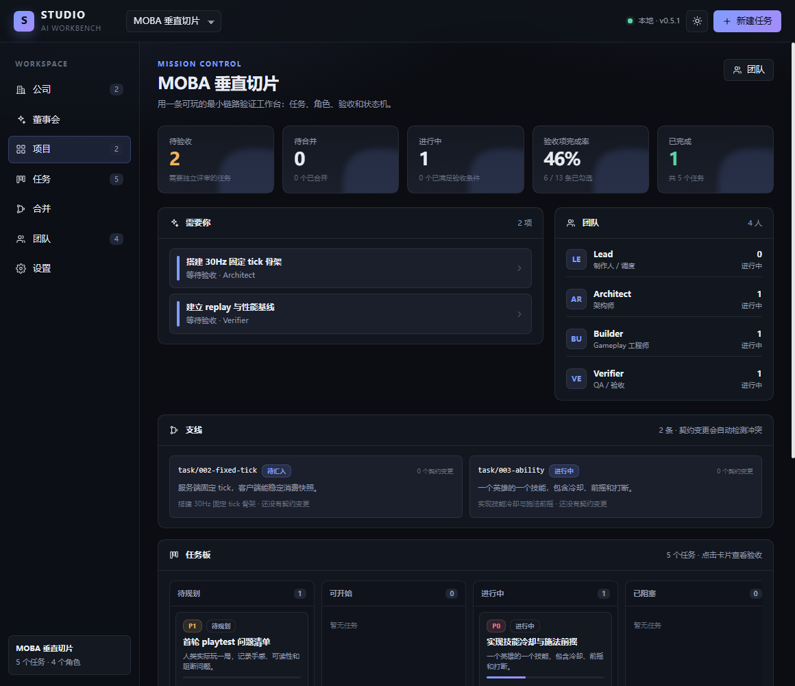

# @ai-workbench/dsh-studio

> 即装即用的 DeepSeek Harness AI 工作台：**公司仪表盘、Agent 派单、token 预算、决策董事会、支线/契约冲突、worktree 代码执行、项目、角色、任务、验收、合并治理**，一个独立页面。

当前版本 **1.1.0**，已在 **DSH 0.2.1-rc.2** 上完成端到端验证（Web/桌面安装、页面渲染、任务创建、验收门禁、合并治理、公司仪表盘、Agent 派单与结构化回执、token 计量、董事会、支线/契约冲突自动升级、git worktree 代码编辑、Host 独立验证、独立 AI 评审、失败 2 次自动升级与重拆、合并前验证门禁、项目知识/模块契约、契约越界护栏、集成/playtest ticket、重启持久化）。




## 它是什么

Studio 把 DSH 从「一个会话」扩展成「一间工作室」：

- **公司仪表盘**：跨项目的项目组合、老板收件箱、角色负载、风险雷达和交付流；token 消耗来自 DSH meter，金额成本等报价接入后再显示。
- **Agent 分析派单**：在 Task Room 把任务派给负责人角色，DSH Agent 读取任务/契约后返回 `summary / evidence / artifacts / decisions / contract_deltas / rejected_options / blockers` 结构化回执。
- **决策董事会**：Agent 的项目级决策建议自动进入待裁决；Owner 在独立页面批准/拒绝并记录结论与理由。Agent 不能替 Owner 拍板。
- **支线/契约冲突**：每次派单自动登记支线；Agent 回执里的 `contractDeltas` 写入契约变更。两条支线改同一契约且内容不同时，自动升级为待裁决决策。
- **worktree 代码执行**：项目绑定 git 仓库后，每个任务自动创建 `.worktrees/<taskId>` 和 `studio/<taskId>` 分支；Agent 在 worktree 内改代码，Run 记录 diff；主工作区不被直接修改。
- **Host 独立验证**：Task Room 的验证命令由 Studio Host 在 worktree 内执行，记录退出码/输出并写 evidence；不依赖 Agent 会话，也不会自动通过验收。
- **工作流护栏**：Task 记录模块/契约/票类型；连续失败 2 次自动 blocked 并升级决策；代码项目没有通过的验证时不能提交合并提案。
- **项目知识层**：绑定 PRD / INVARIANTS / MODULES 路径，只读查看仓库原文；Module 契约卡记录职责、接口摘要、允许/禁止路径与依赖，派单时自动加载对应模块契约。
- **契约护栏**：代码 Run 改动模块契约文件、禁止路径，或越出允许的 `src/`/`test/` 路径时，任务自动 blocked 并生成「契约越界」决策，不静默接受。
- **集成/重拆闭环**：Task 可标记为集成/playtest ticket；连续失败 2 次自动生成 Architect 重拆 ticket（backlog），而不是只留一个决策。
- **独立 AI 评审**：验收人角色另开 Agent 会话，只读 diff 和 Host 验证输出，给出 pass/fail 与具体发现；代码任务没有通过的评审不能 done。
- **角色薪资与预算**：角色可配置模型和单任务/每日 token 预算；项目可配置总 token 预算。
- **项目**：一个项目边界，下面有角色和任务。
- **角色**：持久的职责契约（使命、职责、决策权），不是人设卡。
- **任务**：目标 + 负责人 + 验收人 + 可验证的验收标准 + 证据。
- **验收门禁**：Agent 不能自己把任务标记为完成；必须勾完验收项，并至少记录一条证据。
- **合并治理**：验收通过后可提交合并提案，记录摘要、风险、回滚、评审备注和合并提交；批准、打回、标记已合并都有审计事件。
- **独立页面**：DSH 侧栏出现「工作台」，主区域是一整套 Mission Control，不占用聊天会话。
- **本地持久化**：数据自动写到 `$DSH_HOME/studio/studio.json`，重启不丢；首次运行自动生成演示项目。
- **版本适配**：`engines.dsh >= 0.2.1-rc.2`；宿主只依赖 Web Server 路由、client slots 和 React，不依赖私有 Remote 生成器。

## 安装

### 方式 A：桌面端（推荐）

1. 打开 DSH 的 **Plugins** 页面。
2. **Add plugin** → 选择 **本地目录**，填入：

   ```text
   D:\AI工作台\packages\dsh-studio
   ```

3. 安装完成后点 **Enable now**。
4. 刷新页面；左侧栏出现 **工作台**。
5. 如果打开工作台显示「没有返回启动参数」，请**完全退出并重新打开 DSH**。桌面端的 Host 启动参数表是在应用启动时收集的，热安装后需要重启一次 Host；0.2.1 的 Boot 回退路径会让后续刷新不再依赖这次重启。

> 如果 DSH 不让你直接选目录，先在终端打包，再在 Add plugin 里填 tarball 路径：
>
> ```powershell
> cd D:\AI工作台\packages\dsh-studio
> pnpm pack
> ```

### 方式 B：Web profile

```powershell
dsh plugin --profile web add "D:\AI工作台\packages\dsh-studio"
dsh --profile web
```

打开启动时打印的 URL，左侧栏出现 **工作台**。

### 方式 C：打包分发给别人

```powershell
cd D:\AI工作台\packages\dsh-studio
pnpm pack
```

把生成的 `ai-workbench-dsh-studio-1.1.0.tgz` 发给对方，在 **Add plugin** 里填 tarball 路径即可。

## 使用

首次打开会自动生成一个「MOBA 垂直切片」演示项目、4 个角色和 5 个任务。

1. **公司**：老板视角的项目组合、老板收件箱、角色负载、风险雷达和交付流。
2. **董事会**：Agent 提出的项目级决策、人工提出的决策、跨支线契约冲突；批准/拒绝并记录结论与理由。
3. **项目**：看当前项目的支线、契约变更、任务板、验收、团队和最近事件。
4. **任务**：点卡片打开 Task Room；勾验收项、写证据、推进状态；未绑定仓库时点「派单分析」，绑定仓库后点「派单执行」，Agent 在 worktree 内工作并把 diff 写入 Run；再用「独立验证」跑测试命令。
5. **合并**：查看合并队列；批准、打回、记录合并提交。
6. **团队**：新增角色，写使命/职责/决策权，并配置模型与 token 预算。
7. **设置**：绑定/更换代码仓库，查看 DSH 版本、兼容状态、数据目录和能力边界。


Task Room 里，验收项、证据和状态推进是同一份事实：没勾完、没证据，就无法验收通过。


合并队列把「验收通过」和「合入主干」分开：提案先评审，批准后才记录合并；打回会把任务退回执行中。

核心规则：

- 新建任务必须至少有一条验收标准。
- 任务进入「已完成」前，所有验收项必须勾选，且至少有一条证据。
- 任务验收通过后才能提交合并提案；合并提案必须有摘要、风险和回滚方案。
- 合并提案被打回时，任务退回执行中；需要重新验收后才能再提交。
- 合并命令由人或 Integrator 执行，Studio 记录治理状态和审计事件，不自动改 Git。

## 数据与安全

- 数据文件：`$DSH_HOME/studio/studio.json`（默认 `C:\Users\<你>\.dsh\studio\studio.json`）。
- 每次进程启动生成随机 Bearer token，只注入当前 DSH 页面；数据接口同源、`Cache-Control: no-store`，桌面 Boot 回退使用受控 CORS。
- 不存储模型密钥；不要手动把 token 贴到聊天/日志里。
- 数据损坏时会备份为 `studio.json.corrupt-<timestamp>`，并重建演示数据。
- 旧 schema（v1-v10）会自动迁移到 v11：增加 `mergeProposals`、`runs`、`branches`、`contractChanges`、`decisions`、`verifications`、`reviews`、`modules`、项目仓库/worktree/知识文档路径、任务模块/契约/票类型/集成标记/重拆来源、角色模型/预算字段和项目预算；已有项目/角色/任务不丢失。
- 桌面渲染器运行在 `dsh-app://` 上，因此 `/studio-api/boot` 会对 `dsh-app://` / `null` origin 反射 CORS 并发放进程级 token；数据接口仍然只认这个 token。Web 端的 Boot 路由继续走 DSH 会话认证。

## 版本兼容策略

- `package.json` 的 `engines.dsh` 写成 `>=0.2.1-rc.2`，未来版本不会被硬拒绝。
- Host 使用 `ctx.webServer.register()`、结构化 `webserver/index-inject`、`ctx.connection.admit()`；Client 使用 `ctx.slots`、`ctx.layout` 和平台 React。
- 启动参数有三条路径：页面注入 → 已认证的 `/studio-api/boot` → 桌面自定义 origin 的 Boot 回退（只发放进程级 token，数据接口仍需 token）。
- DSH 版本读取顺序：`@deepseek-ai/dsh-app-boot` → 安装包清单 → 环境变量 → `unknown`。
- 页面会显示兼容状态；能力缺失时显示错误提示，不白屏。
- 如果未来 DSH 改掉 `webServer`、index injection 或 slots，只需替换 `src/host` / `src/client` 的少量适配代码，领域逻辑不动。

## 开发

```powershell
pnpm install
pnpm typecheck
pnpm build
pnpm test
```

> 仓库已带 `lib/` 构建产物，所以可以直接安装；改完 `src/` 后运行 `pnpm build` 重新生成。

构建产物：

- `lib/index.js`：Host 插件（ESM）。
- `lib/client.js`：浏览器模块（DSH module-loader 格式，React 外置）。
- `lib/store.js`：仅供 Node 测试使用的内部构建。

目录：

```text
packages/dsh-studio/
  src/host/       # Cordis 插件、HTTP API、文件存储、版本适配
  src/client/     # React 独立页面、API client、样式
  src/shared/     # 跨端类型、状态机、标签
  tests/          # 存储层单测
  cordis.patch.yml
```

## 当前边界（v1.1）

- ✅ 项目/角色/任务/验收/证据/事件持久化。
- ✅ 独立页面、侧栏入口、主题、响应式。
- ✅ 验收门禁和状态机。
- ✅ 合并提案、批准、打回、合并记录和审计事件。
- ✅ 公司级 Owner Dashboard：项目组合、老板收件箱、角色负载、风险雷达、交付流。
- ✅ Agent 派单与结构化回执；回执缺 `summary`/`evidence` 时任务退回可开始，不能进入验收。
- ✅ 角色模型/token 预算、项目 token 预算、DSH token meter 消耗。
- ✅ 决策董事会：项目级决策持久化、待裁决列表、批准/拒绝、结论与理由、Agent 决策自动入会。
- ✅ 支线自动登记、Agent 契约变更记录、跨支线同契约冲突自动升级为待裁决决策。
- ✅ 项目绑定 git 仓库；每 Task 独立 worktree/branch；Agent 在 worktree 内改代码，Run 记录 branch/workspace/diff。
- ✅ Host 独立验证：验证命令在 worktree 内执行，记录 exit code/输出，通过时写 evidence；不自动通过验收。
- ✅ 工作流护栏：Task 模块/契约/票类型；连续失败 2 次 blocked + 决策升级；代码项目合并前必须有通过的验证。
- ✅ 知识层：PRD/INVARIANTS/MODULES 路径与只读查看；Module 契约卡（职责、契约、允许/禁止路径、依赖）。
- ✅ 契约护栏：代码改动契约文件/禁止路径/越出允许的 src/test 时自动 blocked + 决策。
- ✅ 工作流闭环：集成/playtest ticket 标记；连续失败 2 次自动生成 Architect 重拆 ticket。
- ✅ 独立评审：验收人 Agent 只读 diff/Host 验证，pass/fail + findings；代码任务 done 前必须有通过评审。
- ⏳ 自动生成集成分期 gate、文档同步门禁、不可逆决策、真实 Git merge。
- ⏳ 运行中 token 硬停、金额报价。
- ⏳ Git merge 执行/合并队列（当前仍只记录治理状态，命令由人执行）。
- ⏳ Project Book 检索、角色/Scope 强隔离。
- ⏳ 决策自动生成 ADR 草稿。
- ⚠️ Windows 沙箱在部分 worktree 上可能报 `SetNamedSecurityInfoW grantWrite`，导致 Agent 能改文件但无法启动 shell 跑测试；这属于环境 ACL 限制，Run 会如实记录 blocker。
- ✅ v0.6.1 的 Host 独立验证可以绕过 Agent 会话的 shell 限制，由 Studio 直接执行验证命令；仍不会自动合并或自动通过验收。

v0.6.1 的 Agent 已经能**在独立 worktree 内写代码并产生 diff**，Verifier 可以用 Host 独立验证拿机器证据；但仍不会 merge/push，验收由人决定。

## License

MIT
