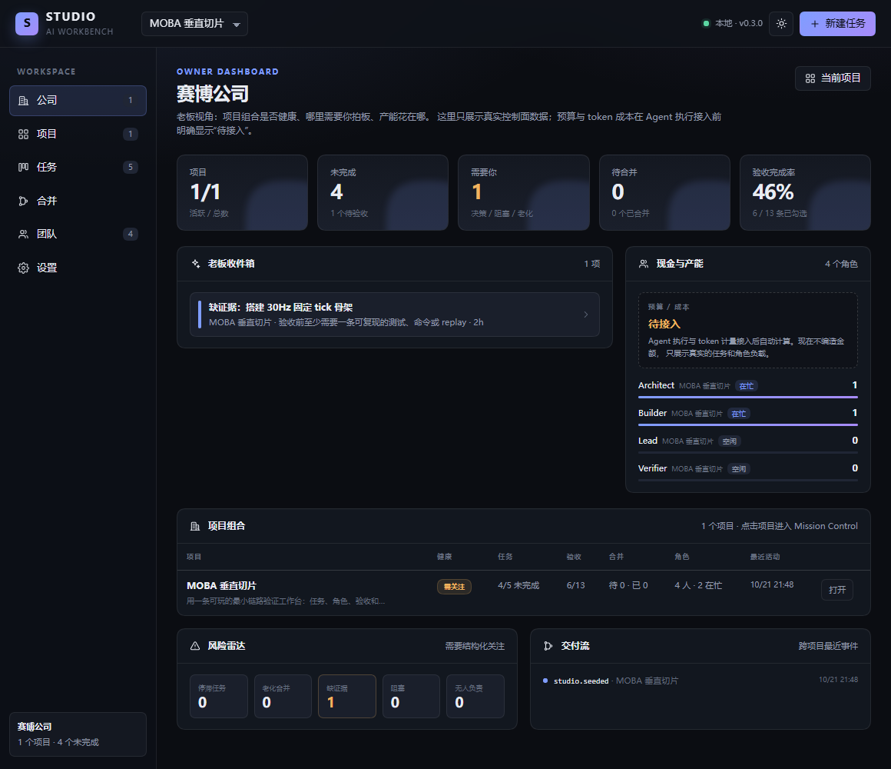
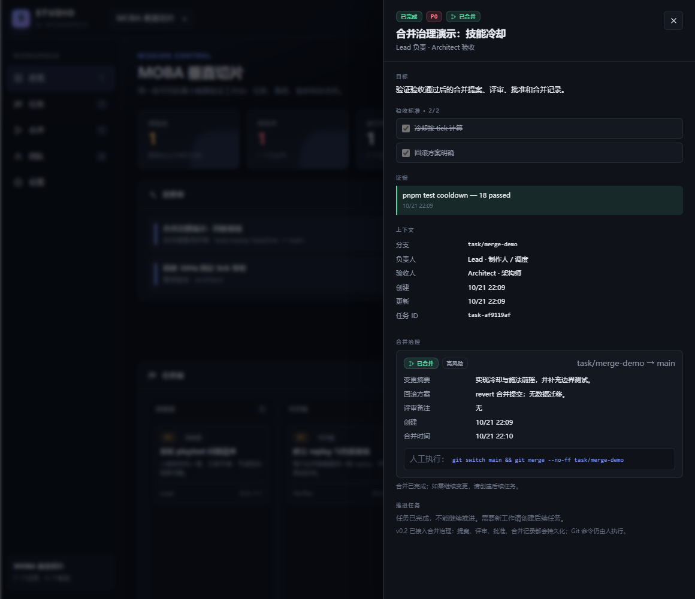
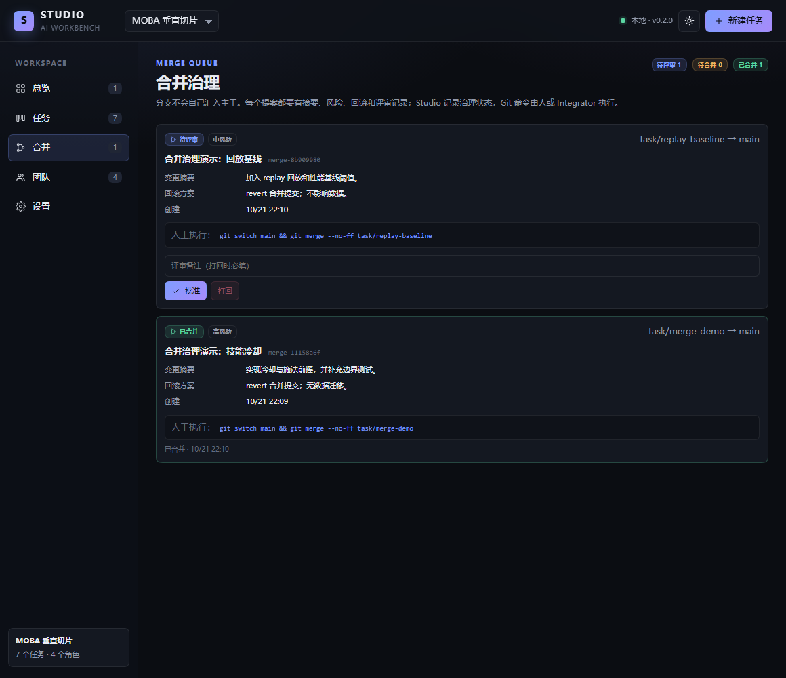

# @ai-workbench/dsh-studio

> 即装即用的 DeepSeek Harness AI 工作台：**公司仪表盘、项目、角色、任务、验收、合并治理**，一个独立页面。

当前版本 **0.3.0**，已在 **DSH 0.2.1-rc.2** 上完成端到端验证（Web profile 实际安装、页面渲染、任务创建、验收门禁、合并提案/批准/合并、公司仪表盘、重启持久化）。



## 它是什么

Studio 把 DSH 从「一个会话」扩展成「一间工作室」：

- **公司仪表盘**：跨项目的项目组合、老板收件箱、角色负载、风险雷达和交付流；预算/成本在 Agent 执行接入前明确显示“待接入”，不编造数字。
- **项目**：一个项目边界，下面有角色和任务。
- **角色**：持久的职责契约（使命、职责、决策权），不是人设卡。
- **任务**：目标 + 负责人 + 验收人 + 可验证的验收标准 + 证据。
- **验收门禁**：Agent 不能自己把任务标记为完成；必须勾完验收项，并至少记录一条证据。
- **合并治理**：验收通过后可提交合并提案，记录摘要、风险、回滚、评审备注和合并提交；批准、打回、标记已合并都有审计事件。
- **独立页面**：DSH 侧栏出现「工作台」，主区域是一整套 Mission Control，不占用聊天会话。
- **本地持久化**：数据自动写到 `$DSH_HOME/studio/studio.json`，重启不丢；首次运行自动生成演示项目。
- **版本适配**：`engines.dsh >= 0.2.1-rc.2`；宿主只依赖 Web Server 路由、client slots 和 React，不依赖私有 Remote 生成器。

## 安装

### 方式 A：桌面端（推荐）

1. 打开 DSH 的 **Plugins** 页面。
2. **Add plugin** → 选择 **本地目录**，填入：

   ```text
   D:\AI工作台\packages\dsh-studio
   ```

3. 安装完成后点 **Enable now**。
4. 刷新页面；左侧栏出现 **工作台**。
5. 如果打开工作台显示「没有返回启动参数」，请**完全退出并重新打开 DSH**。桌面端的 Host 启动参数表是在应用启动时收集的，热安装后需要重启一次 Host；0.2.1 的 Boot 回退路径会让后续刷新不再依赖这次重启。

> 如果 DSH 不让你直接选目录，先在终端打包，再在 Add plugin 里填 tarball 路径：
>
> ```powershell
> cd D:\AI工作台\packages\dsh-studio
> pnpm pack
> ```

### 方式 B：Web profile

```powershell
dsh plugin --profile web add "D:\AI工作台\packages\dsh-studio"
dsh --profile web
```

打开启动时打印的 URL，左侧栏出现 **工作台**。

### 方式 C：打包分发给别人

```powershell
cd D:\AI工作台\packages\dsh-studio
pnpm pack
```

把生成的 `ai-workbench-dsh-studio-0.3.0.tgz` 发给对方，在 **Add plugin** 里填 tarball 路径即可。

## 使用

首次打开会自动生成一个「MOBA 垂直切片」演示项目、4 个角色和 5 个任务。

1. **公司**：老板视角的项目组合、老板收件箱、角色负载、风险雷达和交付流。
2. **项目**：看当前项目的任务板、验收、团队和最近事件。
3. **任务**：点卡片打开 Task Room；勾验收项、写证据、推进状态。
4. **合并**：查看合并队列；批准、打回、记录合并提交。
5. **团队**：新增角色，写使命/职责/决策权。
6. **设置**：查看 DSH 版本、兼容状态、数据目录和能力边界。



Task Room 里，验收项、证据和状态推进是同一份事实：没勾完、没证据，就无法验收通过。



合并队列把「验收通过」和「合入主干」分开：提案先评审，批准后才记录合并；打回会把任务退回执行中。

核心规则：

- 新建任务必须至少有一条验收标准。
- 任务进入「已完成」前，所有验收项必须勾选，且至少有一条证据。
- 任务验收通过后才能提交合并提案；合并提案必须有摘要、风险和回滚方案。
- 合并提案被打回时，任务退回执行中；需要重新验收后才能再提交。
- 合并命令由人或 Integrator 执行，Studio 记录治理状态和审计事件，不自动改 Git。

## 数据与安全

- 数据文件：`$DSH_HOME/studio/studio.json`（默认 `C:\Users\<你>\.dsh\studio\studio.json`）。
- 每次进程启动生成随机 Bearer token，只注入当前 DSH 页面；数据接口同源、`Cache-Control: no-store`，桌面 Boot 回退使用受控 CORS。
- 不存储模型密钥；不要手动把 token 贴到聊天/日志里。
- 数据损坏时会备份为 `studio.json.corrupt-<timestamp>`，并重建演示数据。
- 旧 schema（v1）会自动迁移到 v2：只增加 `mergeProposals` 集合，不改已有项目/角色/任务。
- 桌面渲染器运行在 `dsh-app://` 上，因此 `/studio-api/boot` 会对 `dsh-app://` / `null` origin 反射 CORS 并发放进程级 token；数据接口仍然只认这个 token。Web 端的 Boot 路由继续走 DSH 会话认证。

## 版本兼容策略

- `package.json` 的 `engines.dsh` 写成 `>=0.2.1-rc.2`，未来版本不会被硬拒绝。
- Host 使用 `ctx.webServer.register()`、结构化 `webserver/index-inject`、`ctx.connection.admit()`；Client 使用 `ctx.slots`、`ctx.layout` 和平台 React。
- 启动参数有三条路径：页面注入 → 已认证的 `/studio-api/boot` → 桌面自定义 origin 的 Boot 回退（只发放进程级 token，数据接口仍需 token）。
- DSH 版本读取顺序：`@deepseek-ai/dsh-app-boot` → 安装包清单 → 环境变量 → `unknown`。
- 页面会显示兼容状态；能力缺失时显示错误提示，不白屏。
- 如果未来 DSH 改掉 `webServer`、index injection 或 slots，只需替换 `src/host` / `src/client` 的少量适配代码，领域逻辑不动。

## 开发

```powershell
pnpm install
pnpm typecheck
pnpm build
pnpm test
```

> 仓库已带 `lib/` 构建产物，所以可以直接安装；改完 `src/` 后运行 `pnpm build` 重新生成。

构建产物：

- `lib/index.js`：Host 插件（ESM）。
- `lib/client.js`：浏览器模块（DSH module-loader 格式，React 外置）。
- `lib/store.js`：仅供 Node 测试使用的内部构建。

目录：

```text
packages/dsh-studio/
  src/host/       # Cordis 插件、HTTP API、文件存储、版本适配
  src/client/     # React 独立页面、API client、样式
  src/shared/     # 跨端类型、状态机、标签
  tests/          # 存储层单测
  cordis.patch.yml
```

## 当前边界（v0.3）

- ✅ 项目/角色/任务/验收/证据/事件持久化。
- ✅ 独立页面、侧栏入口、主题、响应式。
- ✅ 验收门禁和状态机。
- ✅ 合并提案、批准、打回、合并记录和审计事件。
- ✅ 公司级 Owner Dashboard：项目组合、老板收件箱、角色负载、风险雷达、交付流。
- ⏳ Agent 派单与执行（下一阶段接入 DSH session/subagent）。
- ⏳ Git worktree、自动合并/合并队列执行（当前只记录治理状态，命令由人执行）。
- ⏳ 真实 token/成本计量与预算门禁。
- ⏳ Project Book 检索、角色卡编译成 DSH Agent Preset。
- ⏳ 权限/Scope 隔离与决策升级门禁。

这不是半成品占位：v0.3 的公司仪表盘、项目、验收和合并治理已经可用；下一阶段会在这个数据模型上接入 Agent 执行层与真实成本。

## License

MIT
